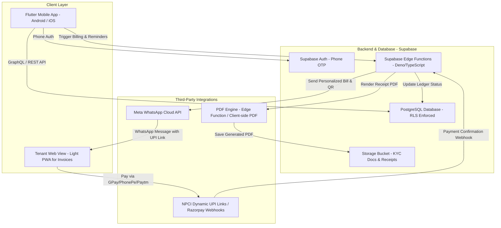

# PG & Rent Manager — Project Blueprint & Master Documentation Index

> **Project Name:** RentKhata / PGManager (Hyperlocal B2B Rent & Utility Automation)  
> **Target Audience:** PG, Hostel, Flat & Sublet Owners across India (Kota, Delhi, Bangalore, Pune, Indore, Patna, Jaipur, Hyderabad)  
> **Documentation Location:** `E:\Project\Reports\Ren_Manager\`  
> **Date of Formulation:** November 2026  
> **Status:** Architecture & Implementation Ready  

---

## 📌 Executive Overview

The **Hostel / PG & Flat Rent Manager** is an intuitive, mobile-first hyperlocal B2B application designed specifically for independent Indian landlords, hostel operators, and PG managers. It automates the most awkward, error-prone, and time-draining aspects of property management:
1. **Awkward Rent Follow-ups:** Replaces manual calls and polite WhatsApp texts with automated, professional WhatsApp reminders containing instant UPI payment links and dynamic QR codes.
2. **Sub-meter Electricity Math:** Eliminates disputes by auto-calculating electricity charges upon entering current meter units and attaching mathematical proof (previous reading, current reading, rate per unit) directly into the bill.
3. **Digital Proof of Payment:** Instantly creates GST/Non-GST compliant branded PDF rent receipts upon payment confirmation, auto-forwarded to tenants and stored in the owner's cloud ledger.
4. **Zero-Friction Financial Engine:** Free for small property owners (up to 3–5 rooms), converting to a pocket-friendly monthly subscription (₹199 – ₹499/month) for commercial operators.

---

## 📚 Complete Documentation Dossier Index

| Document No. | Document Title | Primary Objective | Key Highlights |
| :--- | :--- | :--- | :--- |
| **[01](file:///E:/Project/Reports/Ren_Manager/01_Executive_Summary_and_Vision.md)** | **[Executive Summary & Strategic Vision](file:///E:/Project/Reports/Ren_Manager/01_Executive_Summary_and_Vision.md)** | Problem-solution validation & value proposition | India PG market landscape, pain-points, behavioral psychology, core pillars. |
| **[02](file:///E:/Project/Reports/Ren_Manager/02_Product_Requirements_Document_PRD.md)** | **[Product Requirements Document (PRD)](file:///E:/Project/Reports/Ren_Manager/02_Product_Requirements_Document_PRD.md)** | Detailed feature specification & user stories | Rooms/Beds lifecycle, KYC, billing engine, automated reminders, ledger & expenses. |
| **[03](file:///E:/Project/Reports/Ren_Manager/03_System_Architecture_and_Tech_Stack.md)** | **[System Architecture & Tech Stack](file:///E:/Project/Reports/Ren_Manager/03_System_Architecture_and_Tech_Stack.md)** | Technical design & service topology | Flutter mobile app, Supabase backend (PostgreSQL + RLS + Edge Functions), WhatsApp Cloud API, offline sync. |
| **[04](file:///E:/Project/Reports/Ren_Manager/04_Database_Schema_and_Data_Models.md)** | **[Database Schema & Data Models](file:///E:/Project/Reports/Ren_Manager/04_Database_Schema_and_Data_Models.md)** | Production-ready PostgreSQL DDL & ERD | Relational tables, indexing, foreign keys, triggers for meter billing, and Row Level Security. |
| **[05](file:///E:/Project/Reports/Ren_Manager/05_WhatsApp_Automation_and_UPI_Flows.md)** | **[WhatsApp Automation & Dynamic UPI Engine](file:///E:/Project/Reports/Ren_Manager/05_WhatsApp_Automation_and_UPI_Flows.md)** | Communication & Payment flows | Meta Cloud API setup, bilingual Hinglish templates, dynamic NPCI UPI string generation, automated webhooks. |
| **[06](file:///E:/Project/Reports/Ren_Manager/06_UI_UX_Design_System_and_Wireframes.md)** | **[UI/UX Design System & Wireframe Flows](file:///E:/Project/Reports/Ren_Manager/06_UI_UX_Design_System_and_Wireframes.md)** | Landlord-centric user interface | Simplified 2-click workflows, high contrast UI, room occupancy matrix (Green/Red/Gray), meter photo capture. |
| **[07](file:///E:/Project/Reports/Ren_Manager/07_Business_Model_Monetization_and_GTM.md)** | **[Business Model, Monetization & GTM Strategy](file:///E:/Project/Reports/Ren_Manager/07_Business_Model_Monetization_and_GTM.md)** | Unit economics, revenue roadmap & on-ground sales | Pricing tiers (₹0 / ₹199 / ₹499), Kota/Mukherjee Nagar/Pune GTM playbook, student-referral loops. |
| **[08](file:///E:/Project/Reports/Ren_Manager/08_Development_Roadmap_and_Cost_Estimation.md)** | **[Development Roadmap & Implementation Milestones](file:///E:/Project/Reports/Ren_Manager/08_Development_Roadmap_and_Cost_Estimation.md)** | 30-60-90 Day execution plan | Sprint breakdown, MVP scope, launch checklist, budget & infrastructure expense breakdown. |
| **[09](file:///E:/Project/Reports/Ren_Manager/09_Step_by_Step_Implementation_and_Audit_Plan.md)** | **[Step-by-Step Implementation & Zero-Error Audit Plan](file:///E:/Project/Reports/Ren_Manager/09_Step_by_Step_Implementation_and_Audit_Plan.md)** | 12-Step Implementation Protocol | Strict step-by-step construction, mandatory testing at each step, and 100% tech stack transparency. |

---

## 🛠️ High-Level Technology Blueprint

---

## 🎯 Immediate Next Steps
1. Review the detailed PRD (`02_Product_Requirements_Document_PRD.md`) to finalize the MVP scope.
2. Initialize the Supabase project and execute the SQL schema in `04_Database_Schema_and_Data_Models.md`.
3. Set up the Meta Developer Portal for WhatsApp Cloud API using credentials in `05_WhatsApp_Automation_and_UPI_Flows.md`.
4. Initialize the Flutter workspace repository in `E:\Project\Rent Manager`.
