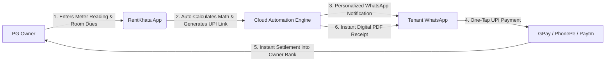

# 01. Executive Summary & Strategic Vision

## 1. Executive Summary

In India's tier-1, tier-2, and educational hub cities (Kota, Delhi, Pune, Bengaluru, Indore, Patna, Jaipur, Hyderabad), the unorganized student hostel and paying guest (PG) market represents a massive, highly cash-flow-rich, yet technologically neglected B2B sector.

Over **90% of PG, hostel, and private flat landlords manage multi-lakh monthly cash flows on paper diaries (*bahi-khata*), spreadsheets, or fragmented WhatsApp chats**. 

This operational model suffers from three persistent friction points:
1. **The Awkward Rent Collection Cycle:** Landlords find it embarrassing and time-consuming to repeatedly call or message tenants (*"Beta, iss mahine ka rent nahi aaya"*). Tenants often delay payments by ignoring informal messages.
2. **The Electricity Sub-Meter Dispute:** Each room or floor has a dedicated sub-meter. Calculating variable electrical units (`(Current - Previous) * Rate`), factoring in shared AC/geyser charges, and justifying the bill to skeptical tenants causes heated arguments every single month.
3. **Receipting & Advance Deposit Accounting:** Tracking refundable security deposits, move-out deductions (painting/damage/unpaid electricity), and issuing official HRA rent receipts for working professionals or college students remains completely chaotic.

**RentKhata (PG & Rent Manager)** solves this with a **zero-friction, hyperlocal B2B platform**. The property owner uses an intuitive, high-utility mobile app, while **tenants require ZERO app downloads**—they interact directly through structured, automated **WhatsApp notifications, Dynamic UPI payment links, and instant PDF receipts**.

---

## 2. Market Landscape & Target Geography

### Key Hub Categories in India
* **Education & Coaching Hubs:**
  * *Kota (Rajasthan):* Over 200,000+ students residing in private hostels and PGs across Talwandi, Vigyan Nagar, Landmark City, and Rajiv Gandhi Nagar.
  * *Delhi (Mukherjee Nagar, Laxmi Nagar, Kalu Sarai, Rajinder Nagar):* Dense concentrations of UPSC, SSC, and engineering aspirants living in partitioned floors and private PGs.
  * *Indore (Bhanwarkuan, Geeta Bhawan) & Patna (Boring Road, Kankarbagh):* Regional coaching epicenters with dense, independent hostel clusters.
* **Tech & IT Corridors:**
  * *Bengaluru (BTM Layout, Koramangala, Marathahalli, Electronic City, HSR Layout).*
  * *Pune (Hinjewadi, Viman Nagar, Kharadi, Kothrud).*
  * *Hyderabad (Madhapur, Gachibowli, Kondapur).*
* **University Clusters:**
  * Delhi University (North & South Campus), Manipal, Dehradun, Greater Noida (Knowledge Park).

---

## 3. The Core Problem Statement & User Psychology

### For the PG / Flat Owner (The B2B User)
* **Age Group:** 40 to 65 years old.
* **Tech Literacy:** Comfortable with WhatsApp, YouTube, and PhonePe/Paytm; intolerant of complex ERPs or enterprise accounting software (e.g., Tally, Zoho).
* **Pain Points:**
  * **Awkwardness & Social Friction:** Chasing rent creates bad blood between landlord and tenant.
  * **Calculation Errors:** Manually computing 20 rooms with different sub-meter readings on paper takes 4–6 hours on the 1st of every month.
  * **Forgotten Dues:** If a tenant leaves without paying the final electricity bill or room damages, the owner absorbs the loss.

### For the Student / Tenant (The B2C End-User)
* **Age Group:** 18 to 28 years old.
* **Tech Literacy:** Digital natives; pay 100% via UPI (Google Pay, PhonePe, Paytm).
* **Pain Points:**
  * Dislike calls or unexpected knocks on the door for rent collection.
  * Lack proof of calculation for arbitrary electricity charges.
  * Need clean PDF receipts for tax exemptions (HRA) or to send to parents for reimbursement.
  * Resistant to downloading yet another app just to pay rent.

---

## 4. The Solution: "RentKhata" Value Proposition

### Strategic Advantage: "Tenant-Zero-App" Philosophy
Unlike competitors (NoBrokerHood, MyGate, Stanza) who force both owner and tenant to install heavy apps, **RentKhata operates purely on WhatsApp for the tenant**. 
* The owner manages properties on the app.
* The tenant receives an official WhatsApp message on the 1st of the month:
  > *"Namaste Rahul! Room 204 ka March 2026 rent bill generate ho gaya hai.*  
  > *Base Rent: ₹7,500*  
  > *Electricity: 64 Units @ ₹10/unit = ₹640 (Reading: 1210 - 1146)*  
  > *Total Due: ₹8,140*  
  > *Pay via UPI: [Pay ₹8,140 Instantly]*"
* Tenant taps the link, chooses PhonePe or Google Pay, and pays directly to the owner's UPI ID.

---

## 5. Monetization Model: Sustainable Hyperlocal B2B SaaS

| Plan Tier | Room / Unit Limit | Price (₹) | Target Audience | Features Included |
| :--- | :--- | :--- | :--- | :--- |
| **Starter (Freemium)** | Up to 3–5 Rooms / Beds | **₹0 Free Forever** | Small home owners renting 1–2 independent floors | Manual WhatsApp shares, basic ledger, sub-meter calculator. |
| **PG Pro (Silver)** | Up to 20 Rooms / Beds | **₹199 / month** (or ₹1,999/year) | Typical standalone 3-floor PG in Kota, Pune, Delhi | Automated WhatsApp API triggers, dynamic UPI QR generation, branded PDF receipts. |
| **Hostel Enterprise (Gold)** | Unlimited Rooms / Multi-Property | **₹499 / month** (or ₹4,499/year) | Large hostel owners (50-150 beds), multi-building owners | Multi-property management, manager/staff accounts, expense & profit analytics, automated SMS/WhatsApp alerts. |

### Unit Economics at a Glance (Local Density Model):
* Acquiring **100 PG owners** in a single cluster (e.g., Kota Landmark City or Delhi Mukherjee Nagar):
  * 70 owners on PG Pro (@ ₹199/mo) = ₹13,930/month
  * 30 owners on Hostel Enterprise (@ ₹499/mo) = ₹14,970/month
  * **Total Monthly Recurring Revenue (MRR):** **₹28,900 / month (~₹3.5 Lakhs ARR)** from just **one locality**.
  * Scaled across 10 educational/IT clusters: **₹2.8 - ₹3.5 Lakhs / month MRR**.

---

## 6. Key Success Metrics (KPIs)

1. **Owner Retention (Stickiness):** Target > 85% monthly retention after the second billing cycle (once tenant data is entered, switching cost is high).
2. **On-Time Collection Rate:** Increase rent collection velocity from an average of 11.4 days to under 3.2 days.
3. **Dispute Reduction:** 90% reduction in electricity billing arguments due to mathematical itemization and meter photo attachments.
4. **Organic Word-of-Mouth (K-Factor):** Target K > 1.2 through PG owner associations and student referral incentives.
