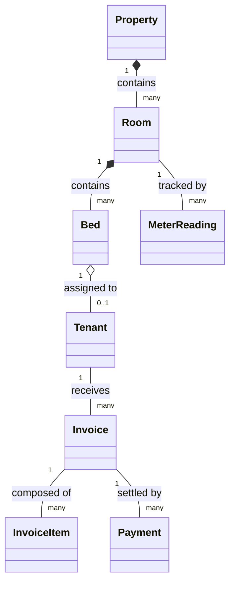

# 02. Product Requirements Document (PRD)

| Metadata | Details |
| :--- | :--- |
| **Product Name** | RentKhata (PG, Hostel & Flat Rent Manager) |
| **Document Version** | 1.0.0 |
| **Target Platforms** | Android (Priority 1), iOS (Priority 2), Web / PWA for Tenant Invoices |
| **Primary Region** | India (Multi-lingual: English & Hinglish) |

---

## 1. Problem Definition & Core Goals

### Primary Objective
Deliver a lightning-fast, ultra-simple mobile management tool for Indian PG and hostel landlords to automate monthly rent reminders, eliminate sub-meter electricity disputes, record security deposits, and collect payments directly via UPI without forcing tenants to install an app.

### Key Goals
1. **Time Saved:** Reduce monthly landlord billing time from 5 hours to under 5 minutes.
2. **Zero Dispute Electricity Billing:** Provide transparent mathematical proof of electricity units (Previous Reading, Current Reading, Units Used, Rate/Unit, and optional meter photo).
3. **Cash Flow Acceleration:** Collect 80%+ of dues within 72 hours of the billing cycle via automated WhatsApp reminders and one-tap UPI links.
4. **Zero-Friction Tenant Experience:** Tenants interact strictly via WhatsApp messages, browser invoice links, and standard UPI apps (GPay, PhonePe, Paytm).

---

## 2. User Personas

### Persona 1: "Sharma Ji" (Small-to-Mid Independent PG Owner)
* **Demographics:** 52 years old, resides in Kota (Talwandi). Owns a 3-storey building with 16 rooms (single and double occupancy).
* **Behavior:** Uses WhatsApp, Facebook, and PhonePe daily. Finds desktop software and complex accounting apps (Tally, Excel) overwhelming.
* **Core Frustration:**
  > *"Every 1st of the month, I have to walk to 16 rooms with a notebook, write down meter units, calculate the bill on a calculator, and call their fathers for rent. It takes 2 full days, and half of them argue about meter readings."*

### Persona 2: "Vikram" (Multi-Property Commercial Manager)
* **Demographics:** 30 years old, manages 3 PG facilities (85 beds total) in Hinjewadi, Pune.
* **Behavior:** Tech-savvy, smartphone-first, tracks business profitability closely.
* **Core Frustration:**
  > *"Tracking who paid cash, who paid via GPay, who has partial dues left, and who is leaving at the end of the month is a nightmare across WhatsApp groups."*

### Persona 3: "Aman" (College Student / Young IT Tenant)
* **Demographics:** 21 years old, preparing for exams in Mukherjee Nagar, Delhi.
* **Behavior:** Digital native; pays everything via UPI. Dislikes landlords calling during study hours.
* **Core Need:**
  > *"I just want a clear breakdown of why my electricity bill is ₹850, a direct UPI link to pay, and a PDF receipt to send to my father so he can reimburse me."*

---

## 3. Product Hierarchy & Entity Model



* **Property (PG / Building / Apartment):** e.g., "Krishna Residency - Boys PG".
* **Room / Flat:** e.g., "Room 101", "Room 202 (AC)", "Flat 3B".
* **Bed (for PG/Hostel sharing):** Bed A, Bed B (enables individual billing for shared rooms).
* **Tenant (Occupant):** Person occupying the bed/room with active lease terms.
* **Sub-Meter:** Associated either with an entire Room or Flat.

---

## 4. Comprehensive Feature Specifications

### Module 1: Property, Room & Bed Setup
* **1.1 Quick Setup Wizard:**
  * Add Property Name, Address, Default Rent Due Day (e.g., 1st of month), and Default Electricity Unit Rate (e.g., ₹10/kWh).
  * Configure Default UPI ID (VPA) for payment collection (e.g., `9876543210@paytm` or `sharmaji@oksbi`).
* **1.2 Room & Bed Matrix:**
  * Support Room Types: Single Private, Double Sharing, Triple Sharing, 1BHK/2BHK/3BHK Flat.
  * Visual status indicators:
    * 🟢 **Green:** Paid (No dues).
    * 🔴 **Red:** Rent Overdue.
    * 🟡 **Yellow:** Partial Payment / Due Today.
    * ⚪ **Gray:** Vacant Bed / Room.

---

### Module 2: Tenant Onboarding & Digital KYC
* **2.1 Profile Capture:**
  * Full Name, Mobile Number (WhatsApp-enabled), Alternate Phone (Parent/Guardian).
  * Institution / Workplace (e.g., "Allen Career Institute" or "Infosys").
  * Move-in Date & Lease Term.
* **2.2 Financial Terms:**
  * Agreed Monthly Base Rent (₹).
  * Security Deposit Amount Received (₹).
  * Maintenance / Food charges (if fixed monthly).
* **2.3 Document Storage (KYC):**
  * Photo capture or PDF upload of Aadhaar Card, Student/Work ID Card.
  * Police verification form generation / export.

---

### Module 3: Sub-Meter Electricity Billing Engine
* **3.1 Sub-Meter Recording Workflow:**
  * System displays `Previous Reading` and `Previous Reading Date`.
  * Landlord enters `Current Reading` on a high-visibility numeric keypad.
  * *Optional:* Snap a quick photo of the physical meter dial as unassailable audit proof.
* **3.2 Mathematical Calculation:**
  $$\text{Units Consumed} = \text{Current Reading} - \text{Previous Reading}$$
  $$\text{Total Electricity Charge} = \text{Units Consumed} \times \text{Rate per Unit (₹)}$$
  *In shared rooms (e.g., Double Sharing), the electricity charge is auto-divided equally between active roommates, or billed to the primary room ledger.*
* **3.3 Validation & Anti-Error Rules:**
  * If $\text{Current Reading} < \text{Previous Reading}$, prompt: *"Current reading cannot be lower than previous reading (1150). Did the meter reset or invert?"*
  * High-consumption alert: If consumption is $>250\%$ of previous month, prompt confirmation: *"Units are unusually high (450 units vs 180 last month). Please confirm."*

---

### Module 4: Dynamic Invoice & Billing Cycle Generation
* **4.1 Automated 1st-of-the-Month Batch Invoicing:**
  * System aggregates:
    1. Base Rent (₹)
    2. Calculated Sub-Meter Electricity (₹)
    3. Food / Mess charges (optional)
    4. Maintenance / Water / WiFi (optional)
    5. Previous Unpaid Dues / Late Fees (if applicable)
    6. Less: Any advance adjustments or discounts.
* **4.2 Pro-Rata Rent Support for Mid-Month Move-Ins:**
  * If tenant moves in on 18th of month:
    $$\text{Pro-Rata Rent} = \left(\frac{\text{Monthly Rent}}{\text{Days in Month}}\right) \times \text{Remaining Days}$$

---

### Module 5: WhatsApp Notification & Dynamic UPI Collection
* **5.1 Message Dispatch Modes:**
  * **Automated Cloud API Mode (Pro/Enterprise):** Dispatches verified Meta WhatsApp Utility Templates instantly on schedule.
  * **Direct WhatsApp Intent Fallback (Free Tier):** Pre-fills the personalized message with payment link into the owner's WhatsApp app with a single tap.
* **5.2 Message Content (Bilingual Hinglish / English):**
  * Salutation with Tenant Name & Room Number.
  * Line-by-line breakdown (Rent + Electricity math with units + Miscellaneous).
  * Dynamic NPCI UPI Deep-Link:
    ```text
    upi://pay?pa={owner_vpa}&pn={owner_name}&am={amount}&tn=Rent_Room_{room_no}_{month}
    ```
  * Web link to view detailed digital invoice and download receipt.
* **5.3 Automated Payment Reminders:**
  * **Day 1 (Bill Generated):** Polite invoice breakdown + UPI pay link.
  * **Day 3 (Due Date Reminder):** Gentle nudge (*"Rent due date is today"*).
  * **Day 5 (Grace Period Alert):** Friendly urgent reminder.
  * **Day 7+ (Overdue Alert):** Formal reminder highlighting pending balance.

---

### Module 6: Payment Recording & Instant Digital Receipts
* **6.1 Multi-Mode Payment Settlement:**
  * **UPI Automatic / Webhook:** Automatic mark-as-paid when paid through integrated payment gateway / virtual account.
  * **Manual Mark as Paid:** For offline payments (Cash, Direct Bank IMPS/NEFT, or Direct P2P UPI without gateway).
  * **Partial Payments:** Supports recording partial settlements (e.g., Total Bill: ₹8,000; Paid: ₹5,000; Balance: ₹3,000 carried over to next invoice).
* **6.2 Automated PDF Rent Receipt Generation:**
  * Generated on fly as a lightweight, professional PDF document.
  * Includes:
    * Receipt No. & Date.
    * Property Name, Owner Name, Contact & Address.
    * Tenant Name, Room No., Bed No.
    * Period of Rent (e.g., 01 March 2026 to 31 March 2026).
    * Payment Breakdown (Rent, Electricity with units, Maintenance).
    * Mode of Payment (UPI / Cash / Bank Transfer) & Transaction/UTR ID.
    * Digital Stamp / "PAID" badge with Owner's Authorized Signature line.
  * Automatically pushed to tenant's WhatsApp within 10 seconds of payment approval.

---

### Module 7: Tenant Move-Out & Security Deposit Settlement
* **7.1 Move-Out Calculator:**
  * Total Security Deposit Held (₹).
  * Deductions:
    * Final pending electricity units from last reading to move-out date.
    * Room damage / painting charges.
    * Unpaid dues / late fees.
  * Net Refundable Amount:
    $$\text{Refund Amount} = \text{Deposit} - (\text{Pending Bills} + \text{Deductions})$$
  * Generates an official "No Dues & Deposit Settlement Clearance Voucher" in PDF.

---

### Module 8: Owner Financial Ledger & Business Analytics
* **8.1 Real-Time Dashboard Metrics:**
  * **Total Expected Revenue (Current Month)**
  * **Total Collected Till Date** (with Cash vs UPI split)
  * **Total Outstanding Dues**
  * **Occupancy Rate:** (e.g., $28/30 \text{ Beds Occupied} = 93.3\%$)
* **8.2 Expense Tracker:**
  * Record operational expenses: Main Electricity Utility Bill, Maid/Cleaning Staff Salary, Cook/Grocery, Plumbing/Repairs, WiFi Bill.
  * Net Monthly Profit = Total Rent Collected - Total Operating Expenses.
* **8.3 Export & Reports:**
  * 1-Click Excel / CSV export for CA / Tax filing.
  * HRA Consolidated Annual Rent Certificates for corporate tenants.

---

## 5. Non-Functional Requirements (NFRs)

| Attribute | Specification |
| :--- | :--- |
| **Performance** | App launch under 1.2s; invoice generation under 300ms; PDF rendering under 1.5s. |
| **Offline-First** | Meter readings and payment records must save locally in SQLite/Hive if the owner is in a basement with no internet, auto-syncing upon reconnection. |
| **Security & Privacy** | Row Level Security (RLS) ensuring strict isolation between different PG owners. Sensitive KYC documents encrypted in private object storage. |
| **Device Compatibility**| Optimized for low-end Android devices (2GB RAM, Android 8.0+) common among independent Indian landlords. |
| **Accessibility & Usability**| High-contrast UI, large touch targets, English/Hindi language toggle, full numpad integration for easy data entry. |
