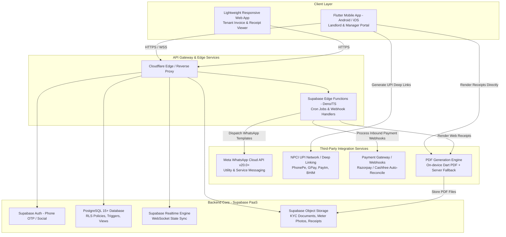
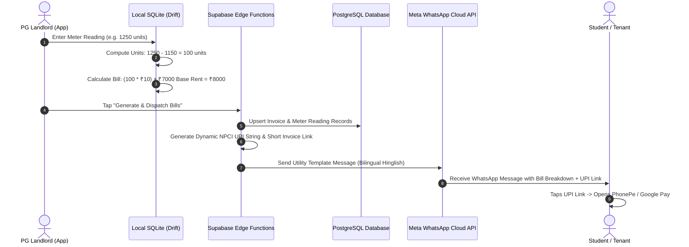
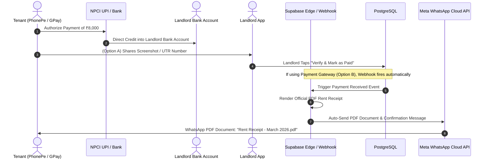

# 03. System Architecture & Tech Stack

## 1. Architectural Principles

To ensure extreme responsiveness on low-to-mid-range Android smartphones, rock-solid financial ledger consistency, and zero tenant adoption friction, the system architecture adheres to four core design principles:

1. **Relational Data Integrity (ACID):** Rent, sub-meter units, deposits, and payments are strictly relational. No NoSQL document drift or balance reconciliation bugs.
2. **Tenant-Zero-App (Web & WhatsApp Only):** Mobile app is exclusively for the property owner/manager. Tenants interact through mobile-optimized web views and WhatsApp messages.
3. **Offline-First with Conflict-Free Sync:** Landlords taking meter readings in basements or cellular dead-zones can record data offline. Changes sync automatically when connectivity resumes.
4. **Zero-Transaction-Fee UPI Priority:** Direct NPCI UPI Intent links enable 0% commission direct bank-to-bank settlement, bypassing expensive 2% payment gateway cuts for bootstrapping owners.

---

## 2. High-Level System Architecture Diagram



---

## 3. Technology Stack Selection & Rationales

| Layer | Technology | Version | Architectural Justification |
| :--- | :--- | :--- | :--- |
| **Mobile App (Frontend)** | **Flutter (Dart)** | 3.24+ | Single codebase for Android & iOS. Unrivalled performance on budget Android phones (Redmi, Realme, Samsung M series). Native camera, local SQLite storage, high-speed UI rendering. |
| **Local State & Offline Storage** | **PowerSync + SQLite / Drift** | Latest | Full bidirectional offline synchronization between mobile device SQLite and Supabase PostgreSQL. |
| **Tenant Web View** | **Next.js / Tailwind CSS (or Pure HTML/Tailwind)** | Latest | Ultra-lightweight SSR/Static web invoice page hosted on Cloudflare Pages. First Contentful Paint < 400ms on 4G networks. |
| **Backend & Database** | **Supabase (PostgreSQL 15+)** | Latest | Relational database with full ACID compliance. Native Row Level Security (RLS) guarantees multi-tenant isolation. Built-in Auth, Storage, and Realtime sync. |
| **Serverless Compute** | **Supabase Edge Functions (Deno)** | Latest | Globally distributed TypeScript edge workers. Handles monthly cron triggers, WhatsApp API dispatch, and webhook processing with zero cold-start overhead. |
| **Messaging Gateway** | **Meta WhatsApp Cloud API** | Graph API v20.0+ | Official, verified green-tick capable WhatsApp integration. 1,000 free service conversations/month; cost-effective utility templates (~₹0.11 - ₹0.30 per template in India). |
| **Payments Layer** | **NPCI Dynamic UPI + Razorpay/Cashfree** | API v2 | **Tier 1:** Native UPI Intent (`upi://pay?pa=...`) for 0% fee direct bank transfer. **Tier 2:** Virtual account webhooks for automated enterprise reconciliation. |
| **PDF Generation** | **`pdf` & `printing` Dart Packages** | Latest | Compiles high-resolution, vector-accurate, print-ready PDF rent receipts and invoices directly on the mobile device in < 150ms without server bandwidth consumption. |

---

## 4. End-to-End Operational Workflows

### 4.1 Monthly Meter Reading & Invoice Generation Sequence



### 4.2 Payment Settlement & Instant Receipt Flow



---

## 5. Offline-First Synchronization Strategy

In Indian PG properties, meter cupboards are frequently located in underground basements, stairwells, or rear alleys with severe cellular signal attenuation. 

### Data Flow for Offline Resilience:
1. **Local Write:** When the landlord records a meter reading or adds a payment, the transaction writes immediately to the local SQLite database.
2. **Optimistic UI:** The UI updates instantaneously with zero loading spinners.
3. **Sync Queue:** The change is recorded in an outgoing local sync mutation log.
4. **Background Reconnection:** A Flutter connectivity listener detects network recovery (`onConnectivityChanged`), batches pending mutations, and submits them to Supabase via idempotent upsert transactions.
5. **Conflict Resolution:** Last-Write-Wins (LWW) based on monotonic client timestamps, with audit timestamps (`updated_at`) enforced by server triggers.

---

## 6. Security & Multi-Tenancy Architecture

* **Database Multi-Tenancy:** Single-database, multi-tenant model. Every primary table (`properties`, `rooms`, `tenants`, `invoices`, `payments`) contains a foreign key `owner_id UUID REFERENCES auth.users(id)`.
* **Row-Level Security (RLS):** Enforced natively in PostgreSQL:
  ```sql
  CREATE POLICY "Owner isolation policy" ON properties
  FOR ALL
  USING (auth.uid() = owner_id);
  ```
  Even in the event of an API misconfiguration, no landlord can ever read or mutate data belonging to another landlord.
* **Sensitive Document Encryption:** Tenant Aadhaar photos, student IDs, and police verification documents are stored in private Supabase Storage buckets accessible solely via short-lived signed URLs (15-minute expiration).
* **PII & Data Protection:** In compliance with India's Digital Personal Data Protection (DPDP) Act 2023, tenant contact details and ID proofs are masked where applicable and encrypted at rest using AES-256.
