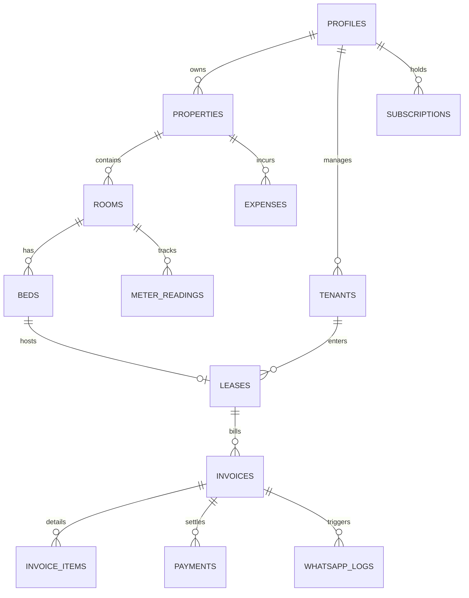

# 04. Database Schema & Data Models

## 1. Entity-Relationship Overview

The database is built on **PostgreSQL 15+ (hosted on Supabase)**, leveraging strict foreign key constraints, enumerated types, table-level check constraints, and Row Level Security (RLS) to ensure absolute multi-tenant data isolation and financial balance consistency.



---

## 2. Production PostgreSQL DDL Script

You can copy and execute the following SQL script directly in the Supabase SQL Editor to initialize the database schema, indexes, triggers, and security rules:

```sql
-- ============================================================================
-- 1. EXTENSIONS & CUSTOM ENUM TYPES
-- ============================================================================
CREATE EXTENSION IF NOT EXISTS "uuid-ossp";

CREATE TYPE property_type AS ENUM ('pg_hostel', 'independent_flat', 'commercial_building');
CREATE TYPE room_sharing_type AS ENUM ('single', 'double', 'triple', 'four_plus', 'full_flat');
CREATE TYPE tenant_status AS ENUM ('active', 'inactive', 'notice_period');
CREATE TYPE invoice_status AS ENUM ('draft', 'pending', 'partially_paid', 'paid', 'overdue', 'cancelled');
CREATE TYPE payment_mode AS ENUM ('upi', 'cash', 'bank_transfer', 'cheque', 'gateway');
CREATE TYPE expense_category AS ENUM ('electricity_main', 'water', 'wifi', 'cleaning_maid', 'cook_grocery', 'maintenance_repairs', 'property_tax', 'other');
CREATE TYPE subscription_tier AS ENUM ('free_starter', 'pro_silver', 'enterprise_gold');

-- ============================================================================
-- 2. USER PROFILE & SETTINGS TABLE (Extends Supabase auth.users)
-- ============================================================================
CREATE TABLE profiles (
    id UUID PRIMARY KEY REFERENCES auth.users(id) ON DELETE CASCADE,
    full_name VARCHAR(150) NOT NULL,
    phone_number VARCHAR(15) UNIQUE NOT NULL,
    business_name VARCHAR(200),
    upi_vpa VARCHAR(100), -- Default UPI ID (e.g., owner@upi)
    upi_account_name VARCHAR(150),
    preferred_language VARCHAR(10) DEFAULT 'hinglish', -- 'en', 'hi', 'hinglish'
    auto_whatsapp_reminders BOOLEAN DEFAULT TRUE,
    created_at TIMESTAMPTZ DEFAULT NOW(),
    updated_at TIMESTAMPTZ DEFAULT NOW()
);

-- ============================================================================
-- 3. PROPERTIES TABLE
-- ============================================================================
CREATE TABLE properties (
    id UUID PRIMARY KEY DEFAULT uuid_generate_v4(),
    owner_id UUID NOT NULL REFERENCES profiles(id) ON DELETE CASCADE,
    name VARCHAR(200) NOT NULL,
    prop_type property_type DEFAULT 'pg_hostel',
    address TEXT NOT NULL,
    city VARCHAR(100) NOT NULL,
    state VARCHAR(100) NOT NULL,
    pincode VARCHAR(10),
    default_rent_due_day INT DEFAULT 1 CHECK (default_rent_due_day BETWEEN 1 AND 28),
    default_electricity_rate NUMERIC(6,2) DEFAULT 10.00, -- Rate per kWh in INR
    default_late_fee_per_day NUMERIC(6,2) DEFAULT 0.00,
    created_at TIMESTAMPTZ DEFAULT NOW(),
    updated_at TIMESTAMPTZ DEFAULT NOW()
);

-- ============================================================================
-- 4. ROOMS & UNITS TABLE
-- ============================================================================
CREATE TABLE rooms (
    id UUID PRIMARY KEY DEFAULT uuid_generate_v4(),
    property_id UUID NOT NULL REFERENCES properties(id) ON DELETE CASCADE,
    room_number VARCHAR(50) NOT NULL,
    floor_number INT DEFAULT 0,
    sharing_type room_sharing_type DEFAULT 'single',
    base_rent_per_bed NUMERIC(10,2) NOT NULL,
    sub_meter_number VARCHAR(100),
    current_meter_reading NUMERIC(10,2) DEFAULT 0.00,
    last_meter_reading_date DATE,
    created_at TIMESTAMPTZ DEFAULT NOW(),
    updated_at TIMESTAMPTZ DEFAULT NOW(),
    UNIQUE(property_id, room_number)
);

-- ============================================================================
-- 5. BEDS TABLE (For granular hostel/PG occupancy)
-- ============================================================================
CREATE TABLE beds (
    id UUID PRIMARY KEY DEFAULT uuid_generate_v4(),
    room_id UUID NOT NULL REFERENCES rooms(id) ON DELETE CASCADE,
    bed_label VARCHAR(20) NOT NULL, -- e.g., 'Bed A', 'Bed B', 'Single'
    is_occupied BOOLEAN DEFAULT FALSE,
    created_at TIMESTAMPTZ DEFAULT NOW(),
    UNIQUE(room_id, bed_label)
);

-- ============================================================================
-- 6. TENANTS TABLE
-- ============================================================================
CREATE TABLE tenants (
    id UUID PRIMARY KEY DEFAULT uuid_generate_v4(),
    owner_id UUID NOT NULL REFERENCES profiles(id) ON DELETE CASCADE,
    full_name VARCHAR(150) NOT NULL,
    phone VARCHAR(15) NOT NULL,
    alternate_phone VARCHAR(15),
    email VARCHAR(150),
    guardian_name VARCHAR(150),
    guardian_phone VARCHAR(15),
    workplace_or_college VARCHAR(200),
    id_proof_type VARCHAR(50) DEFAULT 'Aadhaar',
    id_proof_number VARCHAR(100),
    id_proof_url TEXT,
    tenant_photo_url TEXT,
    status tenant_status DEFAULT 'active',
    created_at TIMESTAMPTZ DEFAULT NOW(),
    updated_at TIMESTAMPTZ DEFAULT NOW()
);

-- ============================================================================
-- 7. LEASES / ALLOCATIONS TABLE
-- ============================================================================
CREATE TABLE leases (
    id UUID PRIMARY KEY DEFAULT uuid_generate_v4(),
    tenant_id UUID NOT NULL REFERENCES tenants(id) ON DELETE RESTRICT,
    bed_id UUID NOT NULL REFERENCES beds(id) ON DELETE RESTRICT,
    start_date DATE NOT NULL,
    end_date DATE,
    agreed_monthly_rent NUMERIC(10,2) NOT NULL,
    security_deposit_amount NUMERIC(10,2) DEFAULT 0.00,
    security_deposit_paid BOOLEAN DEFAULT FALSE,
    is_active BOOLEAN DEFAULT TRUE,
    move_out_notes TEXT,
    created_at TIMESTAMPTZ DEFAULT NOW(),
    updated_at TIMESTAMPTZ DEFAULT NOW()
);

-- ============================================================================
-- 8. SUB-METER READINGS AUDIT LOG
-- ============================================================================
CREATE TABLE meter_readings (
    id UUID PRIMARY KEY DEFAULT uuid_generate_v4(),
    room_id UUID NOT NULL REFERENCES rooms(id) ON DELETE CASCADE,
    reading_date DATE NOT NULL DEFAULT CURRENT_DATE,
    previous_reading NUMERIC(10,2) NOT NULL,
    current_reading NUMERIC(10,2) NOT NULL,
    units_consumed NUMERIC(10,2) GENERATED ALWAYS AS (current_reading - previous_reading) STORED,
    rate_per_unit NUMERIC(6,2) NOT NULL,
    total_amount NUMERIC(10,2) GENERATED ALWAYS AS ((current_reading - previous_reading) * rate_per_unit) STORED,
    meter_photo_url TEXT,
    recorded_at TIMESTAMPTZ DEFAULT NOW(),
    CONSTRAINT chk_readings CHECK (current_reading >= previous_reading)
);

-- ============================================================================
-- 9. INVOICES TABLE
-- ============================================================================
CREATE TABLE invoices (
    id UUID PRIMARY KEY DEFAULT uuid_generate_v4(),
    lease_id UUID NOT NULL REFERENCES leases(id) ON DELETE RESTRICT,
    tenant_id UUID NOT NULL REFERENCES tenants(id) ON DELETE RESTRICT,
    room_id UUID NOT NULL REFERENCES rooms(id) ON DELETE RESTRICT,
    invoice_number VARCHAR(50) UNIQUE NOT NULL, -- e.g., 'INV-2026-03-0101'
    billing_month INT NOT NULL CHECK (billing_month BETWEEN 1 AND 12),
    billing_year INT NOT NULL CHECK (billing_year >= 2024),
    issue_date DATE NOT NULL DEFAULT CURRENT_DATE,
    due_date DATE NOT NULL,
    
    -- Financial line item breakdowns
    base_rent NUMERIC(10,2) NOT NULL DEFAULT 0.00,
    electricity_charges NUMERIC(10,2) NOT NULL DEFAULT 0.00,
    food_mess_charges NUMERIC(10,2) NOT NULL DEFAULT 0.00,
    maintenance_charges NUMERIC(10,2) NOT NULL DEFAULT 0.00,
    other_charges NUMERIC(10,2) NOT NULL DEFAULT 0.00,
    discount_amount NUMERIC(10,2) NOT NULL DEFAULT 0.00,
    late_fee NUMERIC(10,2) NOT NULL DEFAULT 0.00,
    
    -- Calculated summaries
    total_amount NUMERIC(10,2) NOT NULL,
    amount_paid NUMERIC(10,2) DEFAULT 0.00,
    balance_due NUMERIC(10,2) NOT NULL,
    
    status invoice_status DEFAULT 'pending',
    dynamic_upi_link TEXT,
    public_invoice_token UUID DEFAULT uuid_generate_v4(),
    created_at TIMESTAMPTZ DEFAULT NOW(),
    updated_at TIMESTAMPTZ DEFAULT NOW()
);

-- ============================================================================
-- 10. INVOICE LINE ITEMS (Granular Breakdown)
-- ============================================================================
CREATE TABLE invoice_items (
    id UUID PRIMARY KEY DEFAULT uuid_generate_v4(),
    invoice_id UUID NOT NULL REFERENCES invoices(id) ON DELETE CASCADE,
    description VARCHAR(255) NOT NULL,
    amount NUMERIC(10,2) NOT NULL,
    item_type VARCHAR(50) NOT NULL -- 'rent', 'electricity', 'food', 'maintenance', 'late_fee'
);

-- ============================================================================
-- 11. PAYMENTS & RECEIPTS TABLE
-- ============================================================================
CREATE TABLE payments (
    id UUID PRIMARY KEY DEFAULT uuid_generate_v4(),
    invoice_id UUID NOT NULL REFERENCES invoices(id) ON DELETE RESTRICT,
    amount NUMERIC(10,2) NOT NULL CHECK (amount > 0),
    payment_date DATE NOT NULL DEFAULT CURRENT_DATE,
    payment_mode payment_mode DEFAULT 'upi',
    transaction_ref_or_utr VARCHAR(100),
    receipt_number VARCHAR(50) UNIQUE NOT NULL, -- e.g., 'REC-2026-00342'
    receipt_pdf_url TEXT,
    notes TEXT,
    verified_by_owner BOOLEAN DEFAULT TRUE,
    created_at TIMESTAMPTZ DEFAULT NOW()
);

-- ============================================================================
-- 12. EXPENSES TABLE (Operational Outflows)
-- ============================================================================
CREATE TABLE expenses (
    id UUID PRIMARY KEY DEFAULT uuid_generate_v4(),
    property_id UUID NOT NULL REFERENCES properties(id) ON DELETE CASCADE,
    category expense_category NOT NULL,
    amount NUMERIC(10,2) NOT NULL CHECK (amount > 0),
    expense_date DATE NOT NULL DEFAULT CURRENT_DATE,
    title VARCHAR(200) NOT NULL,
    description TEXT,
    receipt_photo_url TEXT,
    created_at TIMESTAMPTZ DEFAULT NOW()
);

-- ============================================================================
-- 13. WHATSAPP NOTIFICATION LOGS
-- ============================================================================
CREATE TABLE whatsapp_logs (
    id UUID PRIMARY KEY DEFAULT uuid_generate_v4(),
    tenant_id UUID NOT NULL REFERENCES tenants(id) ON DELETE CASCADE,
    invoice_id UUID REFERENCES invoices(id) ON DELETE SET NULL,
    recipient_phone VARCHAR(15) NOT NULL,
    template_name VARCHAR(100) NOT NULL,
    message_type VARCHAR(50) NOT NULL, -- 'invoice_due', 'receipt_confirmation', 'reminder'
    meta_message_id VARCHAR(150),
    delivery_status VARCHAR(50) DEFAULT 'dispatched',
    sent_at TIMESTAMPTZ DEFAULT NOW()
);

-- ============================================================================
-- 14. B2B OWNER SUBSCRIPTION MANAGEMENT
-- ============================================================================
CREATE TABLE subscriptions (
    id UUID PRIMARY KEY DEFAULT uuid_generate_v4(),
    owner_id UUID NOT NULL REFERENCES profiles(id) ON DELETE CASCADE,
    plan_tier subscription_tier DEFAULT 'free_starter',
    room_limit INT DEFAULT 5,
    is_active BOOLEAN DEFAULT TRUE,
    started_at TIMESTAMPTZ DEFAULT NOW(),
    expires_at TIMESTAMPTZ,
    razorpay_subscription_id VARCHAR(100)
);
```

---

## 3. High-Performance Indexing Strategy

```sql
-- Indexes for low-latency queries during mobile synchronization
CREATE INDEX idx_properties_owner ON properties(owner_id);
CREATE INDEX idx_rooms_property ON rooms(property_id);
CREATE INDEX idx_beds_room ON beds(room_id);
CREATE INDEX idx_leases_tenant ON leases(tenant_id);
CREATE INDEX idx_leases_bed ON leases(bed_id);
CREATE INDEX idx_invoices_lease ON invoices(lease_id);
CREATE INDEX idx_invoices_status ON invoices(status);
CREATE INDEX idx_invoices_month_year ON invoices(billing_year, billing_month);
CREATE INDEX idx_payments_invoice ON payments(invoice_id);
CREATE INDEX idx_meter_readings_room ON meter_readings(room_id, reading_date DESC);
CREATE INDEX idx_expenses_property_date ON expenses(property_id, expense_date DESC);
CREATE INDEX idx_invoices_public_token ON invoices(public_invoice_token);
```

---

## 4. Business Logic Automation Triggers

### 4.1 Auto-Synchronize Room Reading from Meter Reading Log
```sql
CREATE OR REPLACE FUNCTION update_room_meter_reading()
RETURNS TRIGGER AS $$
BEGIN
    UPDATE rooms
    SET current_meter_reading = NEW.current_reading,
        last_meter_reading_date = NEW.reading_date,
        updated_at = NOW()
    WHERE id = NEW.room_id;
    RETURN NEW;
END;
$$ LANGUAGE plpgsql;

CREATE TRIGGER trg_after_meter_reading_insert
AFTER INSERT ON meter_readings
FOR EACH ROW
EXECUTE FUNCTION update_room_meter_reading();
```

### 4.2 Auto-Recalculate Invoice Status & Balance on Payment Insert
```sql
CREATE OR REPLACE FUNCTION update_invoice_payment_status()
RETURNS TRIGGER AS $$
DECLARE
    v_total_paid NUMERIC(10,2);
    v_total_amount NUMERIC(10,2);
BEGIN
    -- Sum all payments for this invoice
    SELECT COALESCE(SUM(amount), 0) INTO v_total_paid
    FROM payments
    WHERE invoice_id = NEW.invoice_id;

    -- Fetch the invoice total
    SELECT total_amount INTO v_total_amount
    FROM invoices
    WHERE id = NEW.invoice_id;

    -- Update invoice balance and status
    UPDATE invoices
    SET amount_paid = v_total_paid,
        balance_due = GREATEST(0.00, v_total_amount - v_total_paid),
        status = CASE 
            WHEN v_total_paid >= v_total_amount THEN 'paid'::invoice_status
            WHEN v_total_paid > 0 THEN 'partially_paid'::invoice_status
            ELSE 'pending'::invoice_status
        END,
        updated_at = NOW()
    WHERE id = NEW.invoice_id;

    RETURN NEW;
END;
$$ LANGUAGE plpgsql;

CREATE TRIGGER trg_after_payment_insert
AFTER INSERT ON payments
FOR EACH ROW
EXECUTE FUNCTION update_invoice_payment_status();
```

---

## 5. Row-Level Security (RLS) Configuration

```sql
-- Enable RLS across all core tables
ALTER TABLE profiles ENABLE ROW LEVEL SECURITY;
ALTER TABLE properties ENABLE ROW LEVEL SECURITY;
ALTER TABLE rooms ENABLE ROW LEVEL SECURITY;
ALTER TABLE beds ENABLE ROW LEVEL SECURITY;
ALTER TABLE tenants ENABLE ROW LEVEL SECURITY;
ALTER TABLE leases ENABLE ROW LEVEL SECURITY;
ALTER TABLE meter_readings ENABLE ROW LEVEL SECURITY;
ALTER TABLE invoices ENABLE ROW LEVEL SECURITY;
ALTER TABLE payments ENABLE ROW LEVEL SECURITY;
ALTER TABLE expenses ENABLE ROW LEVEL SECURITY;

-- Landlord Profiles
CREATE POLICY "Users can manage own profile" ON profiles
    FOR ALL USING (auth.uid() = id);

-- Properties
CREATE POLICY "Owners can manage own properties" ON properties
    FOR ALL USING (auth.uid() = owner_id);

-- Rooms
CREATE POLICY "Owners can manage rooms" ON rooms
    FOR ALL USING (
        EXISTS (
            SELECT 1 FROM properties 
            WHERE properties.id = rooms.property_id 
            AND properties.owner_id = auth.uid()
        )
    );

-- Invoices (Landlord Full Access)
CREATE POLICY "Owners can manage invoices" ON invoices
    FOR ALL USING (
        EXISTS (
            SELECT 1 FROM tenants 
            WHERE tenants.id = invoices.tenant_id 
            AND tenants.owner_id = auth.uid()
        )
    );

-- Public Read for Invoices (Tenant access via unique token without login)
CREATE POLICY "Tenants can view invoice with valid token" ON invoices
    FOR SELECT USING (public_invoice_token IS NOT NULL);
```
