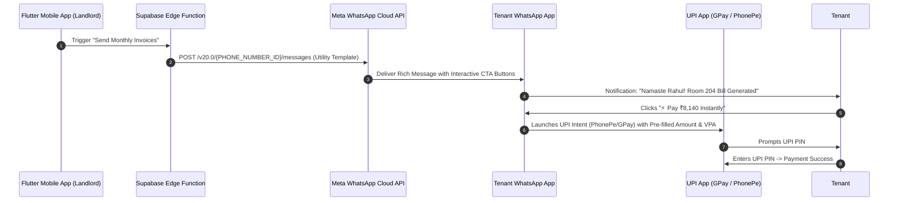
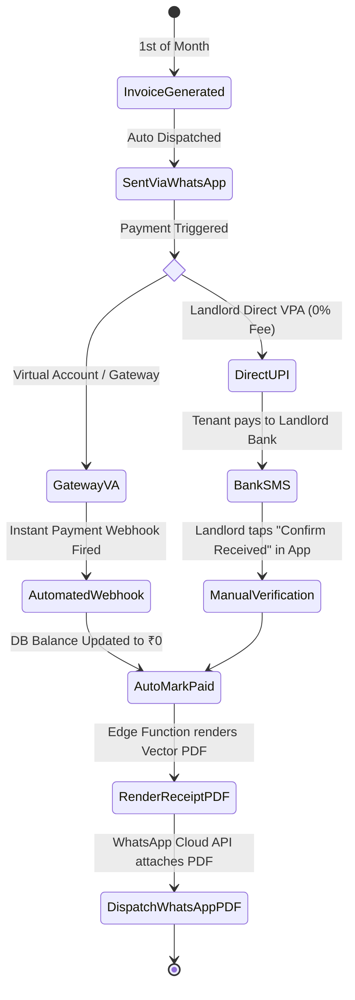

# 05. WhatsApp Automation & Dynamic UPI Engine

## 1. Meta WhatsApp Cloud API Setup & Architecture

To achieve frictionless delivery without forcing tenants to download a dedicated mobile application, **RentKhata** integrates directly with the **Meta WhatsApp Cloud API (Graph API v20.0+)**.



---

## 2. Meta Pricing Model & Free-Tier Strategy (India Region)

| Message Type | Meta Rate (India) | Strategy for RentKhata |
| :--- | :--- | :--- |
| **Service Conversations** | **FREE** (First 1,000 / month) | Used whenever a tenant replies or sends a message first (24-hour customer service window). |
| **Utility Templates** | **~₹0.11 to ₹0.15** per message | Used for official automated monthly rent bills, sub-meter math breakdowns, and PDF receipts. |
| **Direct Intent Fallback (Free Tier)** | **₹0.00 (Zero Cost)** | For landlords on the Free Plan (< 5 rooms): The app generates a pre-formatted WhatsApp deep link (`https://api.whatsapp.com/send?phone=...&text=...`), launching the landlord's personal WhatsApp with the message ready to send with one tap. |

---

## 3. Approved WhatsApp Message Templates

### Template 1: Monthly Rent Bill with Sub-Meter Math
* **Template Name:** `rent_invoice_monthly_v1`
* **Category:** `UTILITY`
* **Language:** Hinglish (`hi_IN` / `en_US`)
* **Header:** Text — `🏠 {{1}} - Monthly Rent Bill`
* **Body:**
  ```text
  Namaste {{2}} ji! 

  Aapke Room No. *{{3}}* ka *{{4}}* mahine ka rent bill generate ho gaya hai:

  🔹 *Base Rent:* ₹{{5}}
  🔹 *Electricity Sub-Meter:* ₹{{6}}
     (Reading: {{7}} se {{8}} = *{{9}} Units* @ ₹{{10}}/unit)
  🔹 *Maintenance / Mess:* ₹{{11}}
  ---------------------------------
  💰 *Total Due Amount:* *₹{{12}}*
  📅 *Due Date:* {{13}}

  Kirpya due date se pehle niche diye gaye link se payment karein. Payment hone par automatic PDF receipt mil jayegi.
  ```
* **Buttons (Interactive CTA):**
  * **Button 1 (Dynamic URL - UPI Pay):**
    * Text: `⚡ Pay ₹{{12}} via UPI`
    * URL: `https://rentkhata.in/pay/{{14}}` *(redirects directly to `upi://pay`)*
  * **Button 2 (Web View - Detailed Invoice):**
    * Text: `📄 View Bill Details`
    * URL: `https://rentkhata.in/invoice/{{14}}`

---

### Template 2: Instant Payment Confirmation & PDF Receipt
* **Template Name:** `payment_receipt_instant_v1`
* **Category:** `UTILITY`
* **Header:** Document (Auto-attaches generated PDF: `Rent_Receipt_{{1}}.pdf`)
* **Body:**
  ```text
  Namaste {{2}} ji,

  Dhanyawad! Aapka Room *{{3}}* ka rent payment safaltapoorvak receive ho gaya hai.

  💵 *Amount Paid:* ₹{{4}}
  🧾 *Receipt No:* {{5}}
  💳 *Payment Mode:* {{6}}
  📌 *Remaining Balance:* ₹{{7}}

  Aapki official digital receipt upar attach kar di gayi hai. Aap isse future proof ya college/HRA ke liye save kar sakte hain.
  ```
* **Quick Reply Button:**
  * Text: `Contact Landlord`

---

### Template 3: Gentle Due Date Reminder
* **Template Name:** `rent_reminder_gentle_v1`
* **Category:** `UTILITY`
* **Body:**
  ```text
  Namaste {{1}}! 

  Reminder: Aapke Room *{{2}}* ka monthly rent *₹{{3}}* aaj due hai (Due Date: {{4}}).

  Agar aapne payment kar diya hai toh kirpya transaction screenshot ya UTR number share karein. Agar bacha hai toh niche diye button se instant pay karein.
  ```
* **Button:**
  * Text: `⚡ Pay Now via UPI`
  * Dynamic URL: `https://rentkhata.in/pay/{{5}}`

---

## 4. Dynamic NPCI UPI Deep-Link Specification

### The NPCI Standard URI Format
Under the National Payments Corporation of India (NPCI) guidelines, a standardized UPI intent URL can trigger all major UPI apps installed on the smartphone (Google Pay, PhonePe, Paytm, BHIM, Navi, Cred).

```text
upi://pay?pa={UPI_VPA}&pn={PAYEE_NAME}&am={AMOUNT}&cu=INR&tn={TRANSACTION_NOTE}
```

### Parameter Encoding Matrix

| Parameter | Key | Example Value | Description |
| :--- | :--- | :--- | :--- |
| **Payee VPA** | `pa` | `sharmaji@oksbi` | Landlord's verified UPI Virtual Payment Address. |
| **Payee Name** | `pn` | `Ramesh Sharma` | Legal name displayed on the payment screen. |
| **Transaction Amount** | `am` | `8140.00` | Exact invoice amount (locks input field so tenant cannot alter). |
| **Currency** | `cu` | `INR` | Standard Indian Rupee. |
| **Transaction Note** | `tn` | `Rent-Room204-Mar2026` | Displays on landlord's bank statement for instant reconciliation. |

### Handling Cross-Platform Redirection (The Web Bridge)
Since WhatsApp web-view sandboxes raw `upi://` schemes, **RentKhata** provides a seamless 10-line redirect bridge hosted at `https://rentkhata.in/pay/{invoice_token}`:

```html
<!DOCTYPE html>
<html>
<head>
    <title>Redirecting to UPI...</title>
    <meta name="viewport" content="width=device-width, initial-scale=1.0">
    <script>
        window.onload = function() {
            var upiUrl = "upi://pay?pa=sharmaji@oksbi&pn=Ramesh%20Sharma&am=8140.00&cu=INR&tn=Rent-Room204";
            // Direct launch attempt
            window.location.href = upiUrl;
            // Fallback: Show manual QR code and buttons if deep-link fails
            setTimeout(function() {
                document.getElementById("manual-section").style.display = "block";
            }, 1800);
        };
    </script>
</head>
<body style="font-family: sans-serif; text-align: center; padding: 24px;">
    <h2>Opening UPI App...</h2>
    <p>Please authorize ₹8,140 in Google Pay, PhonePe, or Paytm.</p>
    <div id="manual-section" style="display:none; margin-top:20px;">
        <p>If app did not open automatically, tap below:</p>
        <a href="upi://pay?pa=sharmaji@oksbi&pn=Ramesh%20Sharma&am=8140.00&cu=INR&tn=Rent-Room204" 
           style="background:#22c55e; color:white; padding:12px 24px; border-radius:8px; text-decoration:none; font-weight:bold;">
           Open UPI App
        </a>
    </div>
</body>
</html>
```

---

## 5. Payment Reconciliation & Receipt Dispatch Workflow



### Reconciliation Modes:
1. **P2P Direct Mode (Default & 0% Cost):**
   * Tenant pays directly into the landlord's personal UPI ID.
   * Landlord receives a real-time bank SMS or notification on their PhonePe Business / Paytm soundbox.
   * Landlord opens RentKhata app, sees the tenant in the "Pending" list, taps **"Mark as Paid"** (one click).
   * System immediately generates the PDF receipt and dispatches it to the tenant's WhatsApp.
2. **Automated Gateway Mode (Pro Plan):**
   * Tenant pays via Razorpay / Cashfree dynamic virtual QR.
   * Gateway hits the Supabase Edge Function webhook.
   * Status automatically flips from `pending` to `paid` without any landlord intervention.
   * Receipt is generated and sent to WhatsApp in < 3 seconds.
