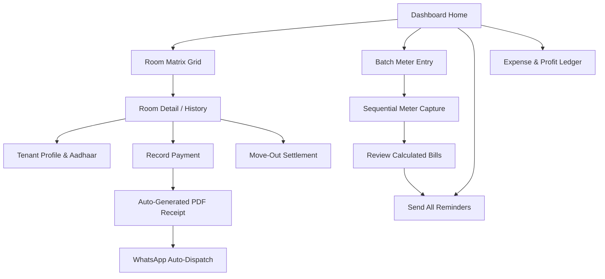

# 06. UI/UX Design System & Wireframe Flows

## 1. Design Philosophy: "Uncle-Friendly" Simplicity

The typical Indian PG owner is between 45 and 65 years old. They rely heavily on WhatsApp, Facebook, and PhonePe, but become frustrated with complex multi-level menus, small fonts, and abstract accounting jargon.

### Core UX Rules
1. **The 2-Tap Rule:** Any frequent operational action (recording a meter reading, confirming a payment, sending a WhatsApp reminder) must be achievable within a maximum of **two taps**.
2. **Visual Hierarchy & Color-Coded Status:**
   * 🟢 **Emerald Green:** Paid / Clean / Occupied with zero dues.
   * 🔴 **Ruby Red:** Rent Overdue (> 3 days past due date).
   * 🟡 **Amber Yellow:** Due Today / Partially Paid.
   * ⚪ **Slate Gray:** Vacant Room / Unoccupied Bed.
3. **Bilingual Hinglish / Hindi Support:** Instant language switch toggle on the home screen (`English` | `हिंदी / Hinglish`).
4. **Thumb-Driven Ergonomics:** Large action buttons placed in the bottom 40% of the screen for comfortable one-handed operation on budget Android devices (6.5" displays).

---

## 2. Design System Tokens

| Token | Value / Spec | Purpose |
| :--- | :--- | :--- |
| **Primary Brand** | `#0D9488` (Teal 600) | Trustworthy, financial, modern. |
| **Success (Paid)** | `#16A34A` (Green 600) | Instant positive feedback for payments. |
| **Urgent (Overdue)** | `#DC2626` (Red 600) | High visibility for pending money. |
| **Background** | `#F8FAFC` (Slate 50) | High readability, low glare. |
| **Card Surface** | `#FFFFFF` (Pure White) | Clean card separation with subtle shadow (`0 2px 4px rgba(0,0,0,0.06)`). |
| **Typography** | `Inter` / `Noto Sans Devanagari` | High legibility across English and Hindi characters. |
| **Touch Target** | Minimum `52 x 52 dp` | Eliminates mis-clicks for older landlords. |

---

## 3. Screen-by-Screen User Flow & Wireframes

### Screen 1: Landlord Master Dashboard

```text
+-------------------------------------------------------------+
| 🏠 Krishna Residency (Kota)           [ 🌐 EN/हिंदी ] [ ⚙️ ] |
+-------------------------------------------------------------+
|  MARCH 2026 COLLECTION STATUS                                |
|  +-----------------------------+--------------------------+  |
|  |  TOTAL COLLECTED            |  PENDING DUES            |  |
|  |  ₹1,42,500                  |  ₹28,500                 |  |
|  |  (18/22 Beds Paid)          |  (4 Beds Pending)        |  |
|  +-----------------------------+--------------------------+  |
|  OCCUPANCY: 22 / 24 Beds (91.6%)                            |
+-------------------------------------------------------------+
|  ⚡ QUICK ACTIONS                                            |
|  [ ⚡ Add Meter Readings ]   [ 📲 Send All Reminders (4) ]   |
+-------------------------------------------------------------+
|  ROOM STATUS (Grid View)                                     |
|                                                             |
|  [ Room 101 - 🟢 ]        [ Room 102 - 🔴 ]                 |
|  Rahul Sharma             Amit Verma                        |
|  Rent: ₹8,000 (PAID)      Due: ₹8,450 (3 Days Late)         |
|  [ 🧾 Receipt ]           [ 📲 Send WA Reminder ]           |
|                                                             |
|  [ Room 103 - 🟡 ]        [ Room 104 - ⚪ ]                 |
|  Vikas & Deepak (Double)  VACANT (Bed A & B)                |
|  Due Today: ₹14,000       Available for Booking             |
|  [ 💵 Settle ]            [ ➕ Add Tenant ]                 |
|                                                             |
+-------------------------------------------------------------+
| [ 🏠 Home ]  [ 🛏️ Rooms ]  [ 👥 Tenants ]  [ 📊 Reports ]   |
+-------------------------------------------------------------+
```

---

### Screen 2: Sub-Meter Rapid Entry Flow (Sequential Mode)

This screen allows the landlord to walk floor-to-floor and record meter readings in less than 90 seconds without navigating back and forth.

```text
+-------------------------------------------------------------+
| < Back              RECORD ELECTRICITY METER         (3 of 12) |
+-------------------------------------------------------------+
|  ROOM 202 - Floor 2                                         |
|  Tenant: Rohit Meena (Bed A) & Sumit (Bed B)                |
+-------------------------------------------------------------+
|  Last Month Reading (01 Feb):  1,146 Units                  |
|                                                             |
|  ENTER CURRENT READING:                                     |
|  +-------------------------------------------------------+  |
|  | [   1 2 1 0   ]                      [ 📷 Snap Photo ] |  |
|  +-------------------------------------------------------+  |
|                                                             |
|  CALCULATION PREVIEW:                                       |
|  Current (1210) - Previous (1146) = 64 Units Consumed       |
|  Rate: ₹10.00 / Unit                                        |
|  Total Electricity Bill: ₹640.00 (₹320 per bed)             |
+-------------------------------------------------------------+
|  NUMERIC KEYPAD                                             |
|     [ 1 ]       [ 2 ]       [ 3 ]                           |
|     [ 4 ]       [ 5 ]       [ 6 ]                           |
|     [ 7 ]       [ 8 ]       [ 9 ]                           |
|     [ . ]       [ 0 ]       [ ⌫ ]                           |
+-------------------------------------------------------------+
|  [ SAVE & NEXT ROOM ➡️ ]                                    |
+-------------------------------------------------------------+
```

---

### Screen 3: One-Tap Rent Settlement & PDF Receipt Modal

Triggered when the landlord receives cash or checks their bank SMS.

```text
+-------------------------------------------------------------+
| RECORD PAYMENT - Room 204 (Rahul Sharma)                    |
+-------------------------------------------------------------+
|  Total Due Amount:  ₹8,140.00                               |
|                                                             |
|  Amount Received:                                           |
|  [ ₹ 8,140.00                                           ]   |
|                                                             |
|  Payment Mode:                                              |
|  (●) UPI (GPay/PhonePe)   ( ) Cash   ( ) Bank Transfer      |
|                                                             |
|  UTR / Reference No (Optional):                             |
|  [ 408291849182                                         ]   |
|                                                             |
|  [X] Send instant WhatsApp PDF Receipt to Tenant (+91 98765) |
+-------------------------------------------------------------+
|  [ CANCEL ]             [ ✅ CONFIRM & SEND RECEIPT ]       |
+-------------------------------------------------------------+
```

---

### Screen 4: Tenant Mobile Web Invoice (Zero-App View)

When the tenant taps the link in their WhatsApp reminder, this ultra-lightweight page opens instantly in their browser:

```text
+-------------------------------------------------------------+
| 🏠 KRISHNA RESIDENCY HOSTEL                                 |
| Kota, Rajasthan | Helpline: +91 98290 XXXXX                 |
+-------------------------------------------------------------+
| INVOICE: #INV-2026-03-0204                                  |
| Tenant: Rahul Sharma | Room: 204 | Month: March 2026        |
| Due Date: 05 March 2026                                     |
+-------------------------------------------------------------+
| CHARGES BREAKDOWN:                                          |
| 1. Room Base Rent (March 2026)               ₹7,500.00      |
| 2. Electricity Bill (64 Units @ ₹10)           ₹640.00      |
|    - Previous Reading: 1,146                                |
|    - Current Reading:  1,210                                |
|    [ 📷 View Meter Photo Attached ]                         |
| ----------------------------------------------------------- |
| TOTAL PAYABLE AMOUNT:                        ₹8,140.00      |
+-------------------------------------------------------------+
|                                                             |
|        [ ⚡ PAY ₹8,140 VIA GOOGLE PAY / PHONEPE ]            |
|                                                             |
|                   --- OR SCAN QR CODE ---                   |
|                   +---------------------+                   |
|                   | [   UPI QR CODE   ] |                   |
|                   | [  (Scan & Pay)   ] |                   |
|                   +---------------------+                   |
|                   UPI ID: sharmaji@oksbi                    |
|                                                             |
|  [ 📥 Download Breakdown PDF ]                              |
+-------------------------------------------------------------+
| 🔒 Secured by RentKhata Direct Settlement                   |
+-------------------------------------------------------------+
```

---

## 4. Landlord Navigation Map


