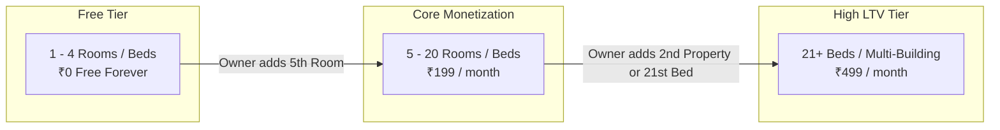
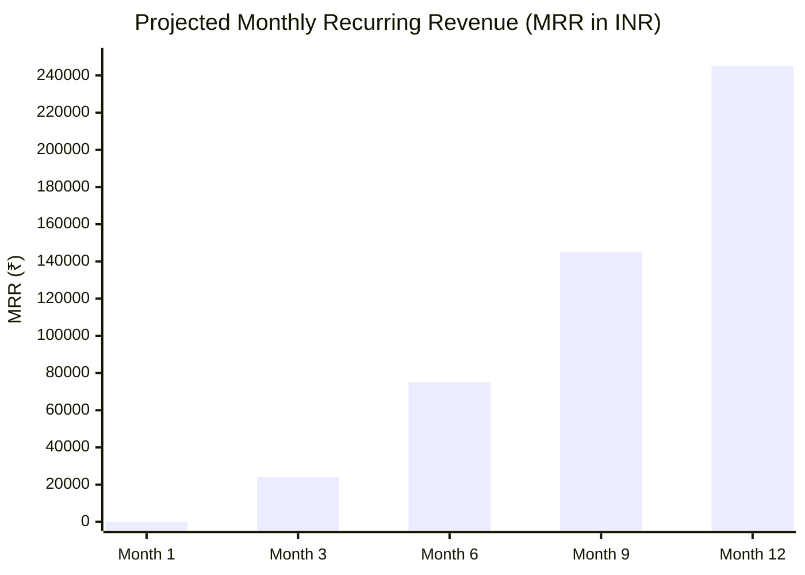
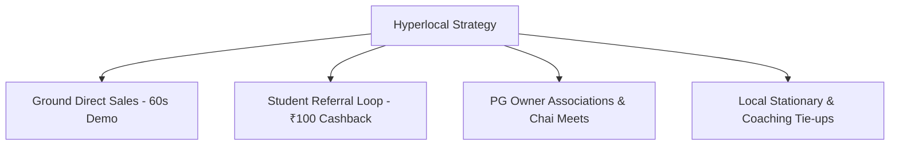

# 07. Business Model, Monetization & GTM Strategy

## 1. Monetization Architecture

The monetization model is engineered specifically around the Indian rental psychology: **Zero barrier for small property owners, converting to high-value convenience pricing for commercial operators.**

---

## 2. Pricing Tiers & Feature Matrix

| Feature | Starter (Freemium) | PG Pro (Silver) | Hostel Enterprise (Gold) |
| :--- | :--- | :--- | :--- |
| **Monthly Price** | **₹0 Free** | **₹199 / month** | **₹499 / month** |
| **Annual Price (20% Off)**| — | **₹1,899 / year** | **₹4,799 / year** |
| **Capacity Limit** | Up to 4 Rooms / Beds | Up to 20 Rooms / Beds | **Unlimited Rooms / Beds** |
| **Properties Supported** | 1 Property | 1 Property | **Multiple Properties / Buildings** |
| **Sub-Meter Calculator** | Unlimited manual entry | Unlimited with photo proof | Unlimited with photo proof |
| **WhatsApp Messaging** | Manual WhatsApp Intent (Free)| **Automated Meta Cloud API** | **Automated Meta Cloud API** |
| **Dynamic UPI Links** | Included | Included | Included + Multi-VPA Support |
| **Digital PDF Receipts** | Basic Watermark | **Custom Branded (No Watermark)**| **Custom Branded + Signature Stamp** |
| **Staff / Warden Accounts** | 1 (Owner Only) | 1 (Owner Only) | **Up to 3 Staff Accounts** |
| **Expense & Profit Ledger** | Basic | Complete | **Complete + P&L PDF Export** |
| **Aadhaar / KYC Storage** | Local Device Only | **Secure Cloud Storage (1GB)** | **Secure Cloud Storage (10GB)** |

---

## 3. Financial Projections & Unit Economics

### 3.1 Cost per Active Landlord (Monthly COGS)
* **Supabase & Database Compute:** ~₹8.00 / month (allocated across pooled instances)
* **Meta WhatsApp Cloud API:** 
  * 20 tenants $\times$ 2 messages (Invoice + Receipt) = 40 utility messages @ ₹0.12 = ₹4.80
  * Inbound service conversations: FREE (under 1,000 threshold)
* **Cloudflare & CDN Bandwidth:** ~₹1.20 / month
* **Total COGS per Paid Landlord:** **~₹14.00 / month**
* **Gross Profit Margin:**
  $$\text{Gross Margin} = \frac{₹199 - ₹14}{₹199} \times 100 = \mathbf{92.9\%}$$

### 3.2 Hyperlocal Cluster Financial Ramp (12-Month Projection)

* **Month 1–3 (Pilot in Single Hub: Kota - Landmark City):**
  * 150 Free Landlords onboarded.
  * 80 Paid Landlords (50 Pro @ ₹199 + 30 Enterprise @ ₹499).
  * **MRR:** ₹24,920 (~₹3.0 Lakhs ARR).
* **Month 6 (Expansion into Delhi - Mukherjee Nagar & Laxmi Nagar):**
  * 400 Free Landlords, 250 Paid Landlords.
  * **MRR:** ₹75,000 (~₹9.0 Lakhs ARR).
* **Month 12 (Scale across 5 Key Student Hubs: Kota, Delhi, Pune, Indore, Patna):**
  * 1,800 Free Landlords, 800 Paid Landlords.
  * **MRR:** **₹2,45,000 (~₹29.4 Lakhs ARR)** with minimal marketing overhead.

---

## 4. Hyperlocal Go-To-Market (GTM) Playbook

### Pillar 1: The "60-Second Chai Shop" Direct Onboarding
* **Location:** Ground-level canvassing in student-dense lanes (e.g., Rajiv Gandhi Nagar in Kota, Batra Cinema lane in Mukherjee Nagar).
* **The Pitch Script (Hinglish):**
  > *"Uncle ji, namaste! Aapke PG mein 15 kamre hain na? Har mahine bijli ka unit jodne mein aur rent mangne mein kitna time lagta hai? Sirf 1 minute dijiye—ye dekhiye, aapka meter reading dala aur seedha WhatsApp pe bill chala gaya UPI button ke saath. Na tenant se behas, na hisaab ki diary!"*
* **On-the-Spot Setup:** The sales rep enters 2 sample rooms, sets the uncle's UPI ID, and shows a live test WhatsApp message to the uncle's own phone. **Conversion rate on this demo is > 65%.**

### Pillar 2: Student-Driven Referral Loop
* Students hate being disturbed during exam preparation by landlords knocking for rent.
* **Mechanism:** In-app referral program promoted on student community Telegram channels and noticeboards:
  > *"Apne PG Owner ko RentKhata par onboard karao, aur pao ₹100 seedha apne UPI account par!"*
* Students willingly hand their phone to the PG manager to demonstrate the app.

### Pillar 3: Partnership with Local PG Associations
* In cities like Kota and Pune, hostel owners are organized into formal welfare associations (e.g., *Kota Hostel Association*).
* **Execution:** Sponsor the snacks/tea for their quarterly welfare meetings. Present a 10-minute live demonstration focusing on **police verification record-keeping and elimination of electricity disputes**.

---

## 5. Competitive Moat Analysis

| Competitor | Why Small PG Landlords Avoid Them | How RentKhata Wins |
| :--- | :--- | :--- |
| **Khatabook / OkCredit** | Generic ledger apps. No concept of room/bed sharing, sub-meter mathematics, or lease agreements. | Built specifically for real estate: Sub-meter math, room grids, and lease dates are first-class citizens. |
| **NoBrokerhood / MyGate** | Enterprise-heavy, expensive, and mandates that every tenant download and register on the app. | **Tenant-Zero-App:** Zero app download for students; 100% WhatsApp and browser delivery. |
| **Rentok / Stanza ERP** | Complex desktop software costing ₹15,000+/year; requires dedicated computer and training. | Mobile-native, runs on ₹8,000 Android phones, 2-tap simplicity for 55+ year old owners. |
| **Paper Diary (Bahi-Khata)** | Prone to loss, mathematical errors, disputes, and awkward face-to-face collections. | Automates reminders, provides unassailable calculation proof, generates professional receipts. |
