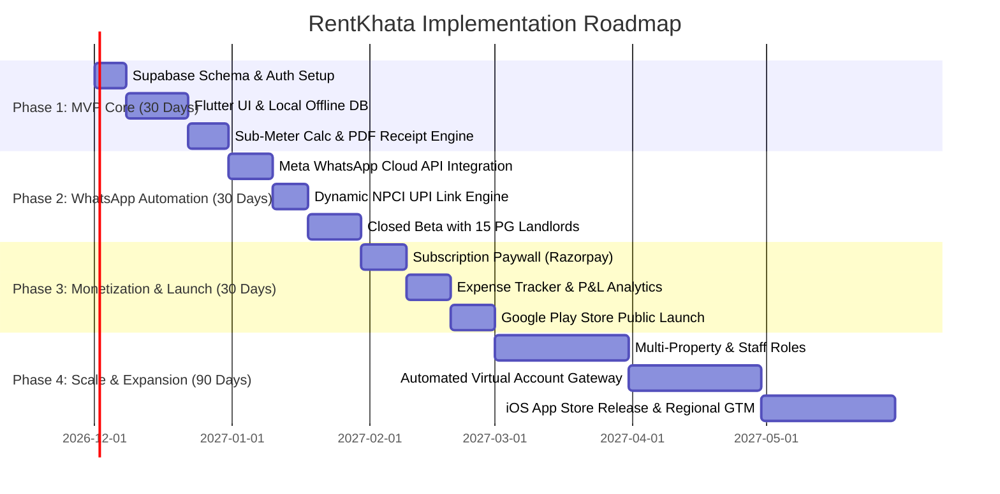

# 08. Development Roadmap, Implementation Milestones & Cost Estimation

## 1. 180-Day Phased Execution Roadmap

The implementation plan is structured into four sequential, value-accretive phases designed to achieve **fast time-to-market (MVP in 30 days)**, validate product-market fit with real PG landlords, and establish stable recurring revenue before scaling.

---

## 2. Sprint-by-Sprint Technical Milestones

### Sprint 1 (Days 1 – 14): Foundational Architecture & Core CRUD
* **Database & Auth:**
  * Provision Supabase PostgreSQL instance and execute schema script (`04_Database_Schema_and_Data_Models.md`).
  * Configure Row Level Security (RLS) policies and automated triggers.
  * Implement Phone Number OTP Authentication for landlords.
* **Property & Room Management (Flutter):**
  * Develop Property creation wizard (Name, Address, default electricity rate, UPI VPA).
  * Build Room & Bed management matrix (Single/Double/Triple sharing setups).
  * Configure local SQLite cache (PowerSync/Drift) for offline resilience.

### Sprint 2 (Days 15 – 30): Billing Math, PDF Engine & Direct WhatsApp Sharing
* **Sub-Meter Billing Engine:**
  * Build sequential meter entry screen with custom numeric keypad.
  * Integrate camera module for meter dial photo capture.
  * Implement instant unit consumption and tariff math calculations.
* **On-Device PDF Generation:**
  * Build vector PDF generator for branded rent receipts and invoice vouchers.
  * Implement instant WhatsApp Intent fallback (`https://api.whatsapp.com/send`) for 1-tap message sharing from landlord's personal WhatsApp.

### Sprint 3 (Days 31 – 45): Meta WhatsApp Cloud API & Dynamic UPI Engine
* **Cloud Messaging Pipeline:**
  * Set up Meta WhatsApp Business Account (WABA) and register utility templates.
  * Deploy Supabase Edge Functions in Deno/TypeScript for automated message dispatch.
  * Build tenant web invoice redirection bridge (`rentkhata.in/pay/...`).
* **UPI Deep-Linking:**
  * Implement standardized NPCI UPI URI generator with dynamic transaction notes.
  * Render SVG/PNG UPI QR codes on tenant web invoice screens.

### Sprint 4 (Days 46 – 60): Closed Beta & Usability Optimization
* **Field Pilot (Kota / Pune):**
  * Deploy internal APK to 15 real PG landlords managing a combined 250+ beds.
  * Shadow landlords during the 1st-of-month meter reading and rent collection cycle.
  * Fix UX bottlenecks, button placement, and Hindi/Hinglish copy clarity.

### Sprint 5 (Days 61 – 90): Monetization, Security & Play Store Launch
* **Subscription & Licensing:**
  * Enforce 4-room limit on Free Starter tier.
  * Integrate Razorpay Subscriptions SDK for automatic monthly/annual recurring billing (₹199 / ₹499).
* **Financial Ledger & Expenses:**
  * Add expense tracking module (electricity main bill, cleaning salary, repairs).
  * Build monthly Cash Flow and Net Profit report generator.
* **Public Release:**
  * Google Play Store submission (Targeting Android 8.0+).

---

## 3. Comprehensive Cost to Launch & Infrastructure Budget

The technical stack is specifically architected to enable **ultra-lean bootstrapping**. The entire project can be built, piloted, and launched for **under ₹15,000 ($180 total capital)**.

### Initial Setup & One-Time Costs

| Item | Service Provider | Estimated Cost (INR) | Mandatory? |
| :--- | :--- | :--- | :--- |
| **Google Play Developer Account** | Google ($25 one-time) | ₹2,100 | Yes (to distribute Android APK) |
| **Apple Developer Account** | Apple ($99/year) | ₹8,300 | Optional (Phase 4 only; Android is 95% of target market) |
| **Domain Registration** | Namecheap / Cloudflare (`rentkhata.in` or `.co.in`) | ₹750 / year | Yes (for invoice web bridge) |
| **SSL & CDN Security** | Cloudflare Free Tier | ₹0 (Free) | Yes |
| **Total One-Time Launch Cost:** | | **~₹2,850** | *(Excluding Apple Developer fee)* |

### Monthly Operating Costs (Bootstrapping vs. Scaling)

| Infrastructure Component | Free / Pilot Phase (0 - 50 Owners) | Growth Phase (50 - 500 Owners) | Scale Phase (500 - 2,500 Owners) |
| :--- | :--- | :--- | :--- |
| **Supabase Backend** | **₹0** (Free Tier: 500MB DB, 50k MAU) | **₹2,100 / mo** ($25 Pro Tier: 8GB DB) | **₹5,000 / mo** (Pro + Extra compute) |
| **WhatsApp Cloud API** | **₹0** (1,000 free service convos + Direct intent) | **₹1,200 / mo** (Utility messages @ ₹0.12) | **₹5,500 / mo** |
| **Cloudflare Hosting & Edge** | **₹0** (Free Tier) | **₹0** (Generous free tier) | **₹1,700 / mo** (Workers Paid) |
| **SMS OTP (Phone Auth)** | **₹0** (Firebase / Supabase free quota) | **₹800 / mo** (Fast2SMS / MSG91 @ ₹0.18/SMS) | **₹3,200 / mo** |
| **Total Monthly Operating Cost:** | **₹0 / month** | **~₹4,100 / month** | **~₹15,400 / month** |
| **Projected Monthly Revenue:** | **₹0 - ₹10,000 / mo** | **₹75,000 - ₹1,50,000 / mo** | **₹4,50,000 - ₹8,50,000 / mo** |
| **Net Operating Margin:** | — | **> 94%** | **> 96%** |

---

## 4. Risk Matrix & Proactive Mitigation Strategies

| Risk Factor | Probability | Impact | Proactive Mitigation Strategy |
| :--- | :--- | :--- | :--- |
| **Meta WhatsApp Spam Flags** | Low | High | Use strictly approved **UTILITY** templates rather than marketing copy. Ensure recipients are verified tenants who have explicitly opted into rent notifications during onboarding. |
| **Landlords Hesitant to Pay Subscription** | Medium | Medium | Provide a **30-day full-feature free trial**. Demonstrate clear ROI: *"Saving 4 hours of calculation time and eliminating one ₹1,000 unpaid electricity loss pays for 5 months of RentKhata Pro."* |
| **Tenant Sub-Meter Tampering Disputes** | High | Low | The app includes a mandatory **"Snap Meter Dial Photo"** feature. The photo is embedded directly into the WhatsApp bill link, providing photographic proof of the reading. |
| **Fake Payment Screenshots / UTR Fraud** | Medium | High | For P2P UPI mode, the app prompts landlords to verify credits in their own bank app before tapping "Confirm Payment". For Enterprise tier, automate settlement via virtual accounts (Cashfree/Razorpay Auto-Collect). |
| **Poor Internet in PG Basements** | High | Medium | Implement an **Offline-First local SQLite architecture**. Meter readings are saved locally and synced automatically once the landlord reconnects to Wi-Fi. |
