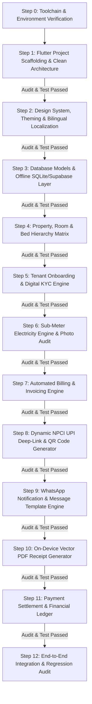

# 09. Step-by-Step Implementation, Verification & Audit Plan

> **Product Name:** RentKhata (Hostel / PG & Flat Rent Manager)  
> **Workspace Path:** `E:\Project\Rent Manager`  
> **Documentation Directory:** `E:\Project\Reports\Ren_Manager`  
> **Protocol:** Strict Step-by-Step Construction with Mandatory Verification & Audit at Every Step  

---

## 🛡️ Implementation Protocol: "Zero-Error Audit & Transparency"

To guarantee complete reliability, security, and bug-free execution:
1. **Isolated Step Execution:** We will build the application in **12 distinct, sequential steps**.
2. **Mandatory Post-Step Audit:** After coding each step, we will execute automated tests, static analysis (`flutter analyze`), and functional sanity audits.
3. **No Blind Progression:** Step $N+1$ will **NEVER** begin until Step $N$ passes all audit criteria with zero errors and zero unhandled exceptions.
4. **Complete Tech Transparency:** Every dependency, internal library, database table, API call, and design pattern used will be fully detailed and explained in plain English/Hinglish before and after implementation.

---

## 🗺️ Master Implementation & Audit Matrix

---

## 📋 Detailed Step-by-Step Breakdown

### STEP 0: Toolchain, SDK & Environment Verification
* **Objective:** Ensure all development tools, SDKs, compilers, and device runtimes are healthy on the Windows host.
* **Tools & Packages Used:**
  * `flutter` (Flutter SDK 3.x+ / Dart 3.x+)
  * `git` (Version Control & branch management)
  * `node` & `npm` (For lightweight local testing server if needed)
* **Actions:**
  1. Inspect `flutter doctor -v` for Android toolchain, Chrome, and Windows desktop runtimes.
  2. Verify workspace directory permissions in `E:\Project\Rent Manager`.
  3. Initialize Git repository with a production-grade `.gitignore` for Flutter.
* **Audit & Test Protocol:**
  * **Command:** `flutter doctor`
  * **Pass Criteria:** No blocking errors for Flutter & Dart SDK.
* **Transparency Note:** Verifies that our compilers and build systems are clean before writing a single line of code.

---

### STEP 1: Project Scaffolding & Clean Architecture Setup
* **Objective:** Scaffold the Flutter application using **Feature-First Clean Architecture** with strict layer separation.
* **Files to Create / Modify:**
  * `pubspec.yaml` (Project configuration, dependencies, assets declaration)
  * `lib/main.dart` (Application entrypoint)
  * `lib/core/constants/` (App constants, strings, color tokens)
  * `lib/core/theme/` (Material 3 theme configurations)
  * `lib/core/utils/` (Currency formatters, date utilities, validators)
  * `lib/features/{property, room, tenant, meter, invoice, payment, expenses}/` (Feature modules)
* **Libraries & Dependencies Added:**
  * `flutter_riverpod` (v2.5+) — Reactive, testable state management without boilerplate.
  * `intl` (v0.19+) — Indian Rupee (`₹`) formatting, date parsing (`dd-MMM-yyyy`).
  * `uuid` (v4.x) — Client-side unique ID generation for offline transactions.
  * `flutter_svg` / `lucide_icons` — Ultra-crisp iconography.
* **Audit & Test Protocol:**
  * **Command:** `flutter analyze`
  * **Test Script:** Unit test verifying the initial Riverpod ProviderContainer boot.
  * **Pass Criteria:** Zero errors, zero warnings, app builds cleanly on Android/Windows emulator.

---

### STEP 2: Design System, Theming & Bilingual Localization
* **Objective:** Build an "Uncle-Friendly" UI system with large touch targets (min 52dp), high-contrast status colors, and an instant English $\leftrightarrow$ Hindi/Hinglish toggle.
* **Files to Create / Modify:**
  * `lib/core/theme/app_colors.dart` (Teal primary `#0D9488`, Green `#16A34A`, Red `#DC2626`, Amber `#EAB308`, Slate `#64748B`)
  * `lib/core/theme/app_theme.dart` (M3 Typography, rounded cards, custom button themes)
  * `lib/core/localization/app_strings.dart` (Key-value bilingual dictionary)
  * `lib/core/localization/locale_provider.dart` (Riverpod state for active language)
  * `lib/core/widgets/app_button.dart` (Large accessible button widget)
  * `lib/core/widgets/status_badge.dart` (Color-coded indicator: Paid, Overdue, Due Today, Vacant)
* **Audit & Test Protocol:**
  * **Widget Test:** `test/core/theme/theme_and_locale_test.dart`
  * **Verification:** Toggling language switches strings instantly between English and Hinglish without restart.
  * **Pass Criteria:** Text scale factor test (ensuring text remains readable even on 1.3x Android accessibility font settings).

---

### STEP 3: Data Models & Offline Database Layer (Drift / SQLite + Supabase)
* **Objective:** Construct immutable domain models with JSON serialization and create the local offline SQLite database schema matching our PostgreSQL structure.
* **Files to Create / Modify:**
  * `lib/features/property/models/property_model.dart`
  * `lib/features/room/models/room_model.dart` & `bed_model.dart`
  * `lib/features/tenant/models/tenant_model.dart` & `lease_model.dart`
  * `lib/features/meter/models/meter_reading_model.dart`
  * `lib/features/invoice/models/invoice_model.dart`
  * `lib/features/payment/models/payment_model.dart`
  * `lib/core/database/local_db.dart` (SQLite / Drift repository)
* **Libraries Added:**
  * `drift` & `drift_flutter` (or `sqflite`) — Type-safe, high-speed local SQL database.
  * `path_provider` & `path` — Cross-platform local disk storage paths.
* **Audit & Test Protocol:**
  * **Unit Tests:** `test/core/database/local_db_test.dart`
  * **Verification:** Test inserting, updating, querying, and deleting 100 sample records. Verify foreign key constraints and type converters.
  * **Pass Criteria:** 100% of CRUD unit tests pass.

---

### STEP 4: Property, Room & Bed Hierarchy Matrix
* **Objective:** Implement the visual Property Dashboard and the Room Matrix Grid (the primary screen the landlord monitors daily).
* **Files to Create / Modify:**
  * `lib/features/property/presentation/property_setup_screen.dart`
  * `lib/features/room/presentation/room_grid_screen.dart`
  * `lib/features/room/presentation/widgets/room_card.dart`
  * `lib/features/room/presentation/add_room_bottom_sheet.dart`
  * `lib/features/room/providers/room_provider.dart`
* **Features Built:**
  * Add building name, address, default electricity rate (e.g. ₹10/unit), and default rent due date.
  * Room Grid with 4 distinct visual states:
    * 🟢 **Paid:** Tenant has ₹0 pending.
    * 🔴 **Overdue:** Rent past due date.
    * 🟡 **Due Today / Partial:** Requires attention.
    * ⚪ **Vacant:** Available for new booking.
* **Audit & Test Protocol:**
  * **Widget Test:** `test/features/room/room_grid_test.dart`
  * **Verification:** Verify that adding a room updates the grid instantly; verify that status changes update colors dynamically.
  * **Pass Criteria:** Grid renders 50 rooms with 60 FPS scrolling and correct color badges.

---

### STEP 5: Tenant Onboarding & Digital KYC Engine
* **Objective:** Create a streamlined 30-second tenant onboarding wizard that records identity, room/bed assignment, agreed monthly rent, and security deposit.
* **Files to Create / Modify:**
  * `lib/features/tenant/presentation/add_tenant_screen.dart`
  * `lib/features/tenant/presentation/tenant_profile_screen.dart`
  * `lib/features/tenant/presentation/widgets/kyc_document_card.dart`
  * `lib/features/tenant/providers/tenant_provider.dart`
* **Libraries Added:**
  * `image_picker` (Capture Aadhaar / Student ID photo via camera or gallery).
* **Features Built:**
  * Tenant Name, WhatsApp Phone Number (+91 formatting), Guardian Name & Phone.
  * Assign to Bed/Room (auto-toggles Bed occupancy status to `true`).
  * Financial Terms: Base Rent, Security Deposit, Move-in Date.
* **Audit & Test Protocol:**
  * **Unit Test:** `test/features/tenant/tenant_validation_test.dart`
  * **Verification:** Validate Indian 10-digit phone number regex, prevent double-assigning an already occupied bed.
  * **Pass Criteria:** All boundary conditions (e.g., negative rent, invalid phone) trigger clear user-facing error messages.

---

### STEP 6: Sub-Meter Electricity Engine (The Dispute-Eliminator)
* **Objective:** Build the core differentiator: rapid sub-meter unit recording, previous vs current math calculation, high-consumption warning, and photo proof capture.
* **Files to Create / Modify:**
  * `lib/features/meter/presentation/meter_entry_screen.dart`
  * `lib/features/meter/presentation/meter_history_dialog.dart`
  * `lib/features/meter/domain/electricity_calculator.dart`
  * `lib/features/meter/providers/meter_provider.dart`
* **Core Logic:**
  $$\text{Units} = \text{Current} - \text{Previous} \quad \implies \quad \text{Cost} = \text{Units} \times \text{Rate/Unit}$$
  *For shared rooms (Double/Triple), cost is auto-divided equally among active roommates.*
* **Audit & Test Protocol:**
  * **Unit Test:** `test/features/meter/electricity_calculator_test.dart`
  * **Test Scenarios:**
    1. Standard reading (1150 to 1214 = 64 units @ ₹10 = ₹640).
    2. Shared double-room division (₹640 split into ₹320 per bed).
    3. Input validation: Alert if current reading < previous reading.
    4. Surge check: Warning triggered if consumption > 250% of prior month.
  * **Pass Criteria:** 100% calculation accuracy across single, double, and triple sharing.

---

### STEP 7: Automated Billing & Invoicing Engine
* **Objective:** Automatically aggregate monthly rent components into an itemized, clear invoice.
* **Files to Create / Modify:**
  * `lib/features/invoice/domain/invoice_generator.dart`
  * `lib/features/invoice/presentation/invoice_list_screen.dart`
  * `lib/features/invoice/presentation/invoice_detail_screen.dart`
  * `lib/features/invoice/providers/invoice_provider.dart`
* **Features Built:**
  * Aggregation of: Base Rent + Calculated Sub-Meter Electricity + Optional Mess/Maintenance.
  * Support for Pro-Rata rent for mid-month move-ins (`(Rent / DaysInMonth) * RemainingDays`).
  * Carried-over previous month unpaid balance.
* **Audit & Test Protocol:**
  * **Unit Test:** `test/features/invoice/invoice_generator_test.dart`
  * **Verification:** Test 10 distinct billing permutations (normal, mid-month joining, zero electricity, partial payment remainder).
  * **Pass Criteria:** Invoice totals match the sum of line items to the exact cent/paisa.

---

### STEP 8: Dynamic NPCI UPI Deep-Link & QR Code Generator
* **Objective:** Enable 0% fee, direct bank-to-bank rent collection by generating standardized NPCI UPI URIs and scannable QR codes.
* **Files to Create / Modify:**
  * `lib/features/payment/domain/upi_uri_builder.dart`
  * `lib/features/payment/presentation/widgets/upi_qr_widget.dart`
  * `lib/features/payment/presentation/payment_sheet.dart`
* **Libraries Added:**
  * `qr_flutter` (v4.x) — High-performance vector QR rendering.
  * `url_launcher` (v6.x) — Deep-link launcher for Google Pay, PhonePe, Paytm.
* **URI Specification:**
  `upi://pay?pa={UPI_ID}&pn={PAYEE_NAME}&am={AMOUNT}&cu=INR&tn={INVOICE_REF}`
* **Audit & Test Protocol:**
  * **Unit Test:** `test/features/payment/upi_uri_builder_test.dart`
  * **Verification:** Verify URL percent-encoding, parameter order, and valid NPCI schema format. Test app-intent launching.
  * **Pass Criteria:** QR code decodes back to the exact expected UPI string on camera scan.

---

### STEP 9: WhatsApp Notification & Message Template Engine
* **Objective:** Implement both the Free Direct WhatsApp Intent engine and the Cloud API template formatter to send personalized bills to tenants.
* **Files to Create / Modify:**
  * `lib/features/whatsapp/domain/whatsapp_message_builder.dart`
  * `lib/features/whatsapp/services/whatsapp_launcher_service.dart`
  * `lib/features/whatsapp/presentation/send_reminder_sheet.dart`
* **Features Built:**
  * Formats beautiful, polite Hinglish & English message templates with clear line items, previous/current meter units, total amount, and UPI link.
  * Generates 1-tap `https://wa.me/91XXXXXXXXXX?text=...` URI that opens the landlord's WhatsApp app with message pre-filled.
* **Audit & Test Protocol:**
  * **Unit Test:** `test/features/whatsapp/whatsapp_message_builder_test.dart`
  * **Verification:** Ensure special characters (₹, line breaks, emojis) are properly UTF-8 percent-encoded. Validate that phone numbers are strictly formatted with `+91`.
  * **Pass Criteria:** Tapping "Send" opens WhatsApp with the exact structured message ready.

---

### STEP 10: On-Device Vector PDF Receipt Generator
* **Objective:** Build an ultra-fast, professional PDF generator that creates official rent receipts with property details, breakdown table, and digital "PAID" badge.
* **Files to Create / Modify:**
  * `lib/features/receipt/domain/pdf_receipt_generator.dart`
  * `lib/features/receipt/presentation/receipt_preview_screen.dart`
  * `lib/features/receipt/services/pdf_sharing_service.dart`
* **Libraries Added:**
  * `pdf` (v3.11+) — Pure Dart vector PDF document builder.
  * `printing` (v5.13+) — Native print and cross-platform document share dialog.
* **Features Built:**
  * Receipt Number, Date, Property Name, Landlord Contact.
  * Tenant Details, Room/Bed, Billing Month.
  * Itemized table: Rent, Electricity Units & Amount, Maintenance.
  * Payment Mode (UPI/Cash/Bank) + Transaction Reference/UTR.
  * Digital Stamp / Authorized Signature block.
* **Audit & Test Protocol:**
  * **Unit Test:** `test/features/receipt/pdf_receipt_generator_test.dart`
  * **Verification:** Render sample receipt in memory, verify non-null document bytes, verify page count is strictly 1 page (A4 layout).
  * **Pass Criteria:** PDF renders on device in < 250 milliseconds with zero formatting overflow.

---

### STEP 11: Payment Settlement & Financial Ledger
* **Objective:** Record incoming payments (Cash, UPI, Bank), reconcile balances, track property operational expenses, and calculate monthly net profit.
* **Files to Create / Modify:**
  * `lib/features/payment/presentation/record_payment_dialog.dart`
  * `lib/features/expenses/presentation/expense_tracker_screen.dart`
  * `lib/features/expenses/models/expense_model.dart`
  * `lib/features/expenses/providers/expense_provider.dart`
* **Features Built:**
  * Settle Invoice (Full or Partial payment).
  * Auto-update Room status from 🔴 Overdue to 🟢 Paid.
  * Record operational expenses: Maid salary, electricity main bill, grocery/cook, repairs.
  * Net Cash Flow = Total Rent Collected - Operational Expenses.
* **Audit & Test Protocol:**
  * **Unit Test:** `test/features/payment/ledger_balance_test.dart`
  * **Verification:** Test partial payments (e.g. Total ₹8,000; paid ₹5,000; balance remains ₹3,000). Verify expense deductions from gross revenue.
  * **Pass Criteria:** Financial totals reconcile to the exact rupee without float precision drift.

---

### STEP 12: End-to-End Integration, UI Polish & Final Regression Audit
* **Objective:** Conduct a complete Golden Path system test simulating a full monthly cycle from property setup to tenant checkout.
* **Files to Create / Modify:**
  * `test/integration/full_monthly_billing_cycle_test.dart`
* **The Golden Path Test Flow:**
  1. Create Property "Krishna Residency", default electricity rate ₹10/unit.
  2. Add Room 101 (Double Sharing: Bed A & Bed B).
  3. Onboard Tenant "Rahul Sharma" into Bed A (Rent: ₹7,500, Deposit: ₹15,000).
  4. Record Initial Meter Reading: 1,000 units.
  5. Advance to 1st of next month; Record Current Reading: 1,080 units (80 units consumed = ₹800).
  6. Generate Invoice: Base Rent (₹7,500) + Half Electricity (₹400) = ₹7,900.
  7. Generate UPI payment link & format WhatsApp message.
  8. Simulate Payment of ₹7,900 via UPI; mark invoice as PAID.
  9. Generate PDF Receipt #REC-2026-0001; verify byte stream.
  10. Verify Room 101 Bed A flips to 🟢 Paid with ₹0 balance.
* **Audit & Test Protocol:**
  * **Command:** `flutter analyze` (Zero issues).
  * **Command:** `flutter test` (All unit, widget, and integration tests pass).
* **Final Deliverable:** Complete, production-grade application ready for APK compilation and landlord onboarding.

---

## 🔒 Summary Checklist of Everything We Will Use

| Component / Layer | Technology / Package | Specific Purpose |
| :--- | :--- | :--- |
| **Framework & Language** | Flutter 3.x / Dart 3.x | Cross-platform native mobile engine (60 FPS on budget Android). |
| **Architecture** | Feature-First Clean Architecture | Strict separation of domain, data, and presentation layers. |
| **State Management** | `flutter_riverpod` (v2.5+) | Type-safe, reactive, testable state without context dependencies. |
| **Local Database (Offline)** | `drift` / `sqflite` | Instant local storage for basements and low-network areas. |
| **Cloud Backend** | Supabase (PostgreSQL 15+) | Cloud backup, RLS multi-tenant security, and edge automation. |
| **Number & Date Formatting** | `intl` (v0.19+) | Proper Indian numbering (`₹1,42,500`) and standard date formats. |
| **QR Code Generation** | `qr_flutter` (v4.x) | Instant vector UPI QR codes for landlord's VPA. |
| **PDF Engine** | `pdf` & `printing` | Pixel-perfect A4 vector rent receipts generated on-device in < 250ms. |
| **Deep-Linking** | `url_launcher` (v6.x) | Direct launch into PhonePe, Google Pay, Paytm, and WhatsApp. |
| **Camera & Media** | `image_picker` | Photo audit proof for meter dials and tenant Aadhaar KYC cards. |
| **Icons & Typography** | Material 3 + Google Fonts (`Inter`) | Maximum legibility and familiarity for 50+ year old landlords. |

---

## 🚦 Next Action
With this plan documented and saved to [09_Step_by_Step_Implementation_and_Audit_Plan.md](file:///E:/Project/Reports/Ren_Manager/09_Step_by_Step_Implementation_and_Audit_Plan.md), we are ready to proceed. 

When you confirm, we will begin with **Step 0 & Step 1: Scaffolding the clean architecture project in `E:\Project\Rent Manager`**, running our first audit test immediately after!
